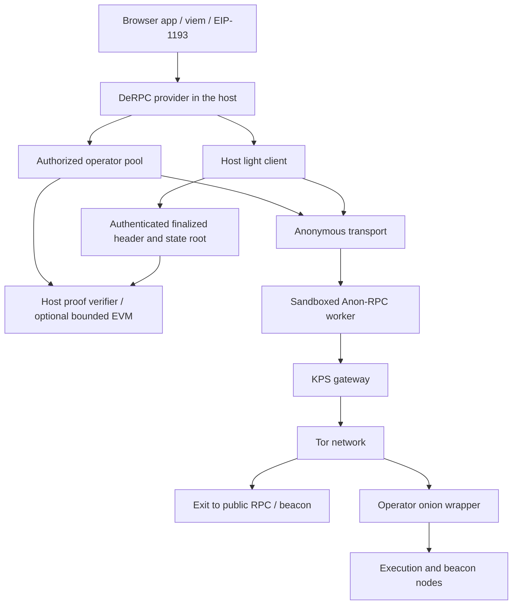

# DeRPC architecture

DeRPC is a browser-side, finalized Ethereum read provider. The host authenticates state and checks answers; an untrusted Anon-RPC worker carries requests through Tor. A bad answer is rejected and its endpoint excluded; the read may recover through another eligible endpoint. Unavailable transport or a stale authenticated header stops the read. There is no direct RPC recovery path.

This describes the implemented boundaries. [CONTEXT.md](specs/CONTEXT.md) records decisions, [OPERATIONS.md](specs/OPERATIONS.md) distinguishes local evidence from public deployment, and [THREAT_MODEL.md](THREAT_MODEL.md) lists residual risks.

The arrows describe request paths and verification dependencies, not a claim that a gateway, endpoint or operator is honest. The wrapper filters work and can serve proofs; only the host decides whether an answer is valid.

## Startup and a read

1. The host supplies the worker specifier's hash and bundle resolvers from pinned local configuration. The harness verifies the downloaded bundle before executing it. Bundle delivery happens before the anonymous worker exists and is a separately disclosed connection.
2. The light client starts from a pinned checkpoint and verifies sync-committee updates fetched through the worker. The polling adapter does not open a direct beacon event stream. Stale checkpoints, invalid updates and stale headers are refused.
3. Through the authorized execution pool, the host proves the mainnet specifier's storage slot 1 and compares it to the pinned worker hash. Account reads wait for this gate.
4. The pool sends a supported request to an eligible selected endpoint. The host verifies account/storage Merkle-Patricia proofs against one authenticated state root, and code against the proven account's code hash. It derives the returned value from the verified data.
5. Before returning or caching, it checks freshness, cancellation and authorization again. A changed selection, expired directory snapshot or transport shutdown cannot make an old pending result newly authorized.

See [the provider API](provider/README.md) for exact options and errors. `"latest"` and historical selectors are refused; callers use `"finalized"`. The optional local EVM executes bounded calls against proven account, storage and code dependencies. A remote `eth_call` response is never accepted as proof, and unsupported context or CCIP-Read is refused.

## Operator selection and discovery

Manual routing uses the user's selected operators. Automatic routing is explicit: balanced, fastest or reliable, optionally restricted to an exact allowlist. An empty allowlist closes the pool. Measurements are recent observations on this device, not global reputation or proof of future honesty. The account keeps its eligible operator; retries are bounded and sequential, with a fresh circuit key on failure. A proof failure excludes the endpoint for the current provider instance.

The built-in bootstrap roster has mock ENS names. Real ENS admission requires separate evidence for registrar membership and resolver records. The registrar is curated, listings expire, and the parent owner can change its registry pointer. A proven snapshot has a ten-minute lease capped at 30 minutes after its authenticated block timestamp; replaying the same block does not renew it. Rotation or delisting affects the client after a finalized, verified refresh, not when a transaction is submitted.

[M1](specs/ENS_TOR_MILESTONE.md) defines the plural endpoint record and operator-first selection: several nodes provide redundancy for one operator, without extra operator selection weight. Its live completion still requires independent operator registrations and lifecycle observations. A subname or multiple URLs alone establishes neither independent ownership nor service quality.

## Wrapper and payments

The [operator wrapper](wrapper/README.md) exposes bounded proof/code requests, four beacon light-client routes and a reciprocal identity document over an onion service. Personal access uses a separate unpublished listener and in-memory client credentials. The wrapper contains no Tor gateway; clients reject known common gateway/operator ownership, while undisclosed ownership remains unknowable.

Payments default off. The separate test-payment path has a prepaid escrow, per-operator sessions and cumulative vouchers signed by the host only after verification. The wrapper durably records accepted vouchers and settlement transactions. App sponsorship adds spending limits and independent evidence verification. Payment-chain verification is separate from mainnet read verification; wallet deposits and operator settlement have their own declared RPC connections. These connections cannot serve browser reads as a fallback.

The Hoodi escrow deployment is recorded in [the public manifest](contracts/deployments/payment-hoodi-deployment-2026-11-06.json). It does not establish a public paid-read/settlement cycle. Query escrow is not staking, and no traffic-dependent staking formula has been chosen.

## Trust and exposure

| Component | Assumption or information exposed |
| --- | --- |
| Checkpoint, app and verifier | The user trusts the checkpoint source, shipped host code and verification implementation, plus Ethereum's consensus assumptions. |
| Worker | Pinned code is identifiable but still untrusted; it can observe requests, tamper, censor or fail. Proof verification remains in the host. |
| Page host and bundle delivery | See their direct connections. A bundle hash protects integrity, not download anonymity. |
| Gateway | Sees the client's IP and encrypted Tor traffic; common ownership and traffic correlation remain risks. |
| Execution/beacon endpoints | See query content and timing. Tor does not provide query-content privacy. |
| ENS governance | Parent owner and curator affect admission and availability. Proven records do not certify operator behavior. |
| Paid service | Knows the funded session and can link its queries to the payer. The browser keeps private signing keys out of the worker. |

No account-unlinkability, global reputation, independent security audit, sustained uptime or production payment-readiness claim follows from the existing tests. The [release gates](specs/OPERATIONS.md) name the evidence still needed.
