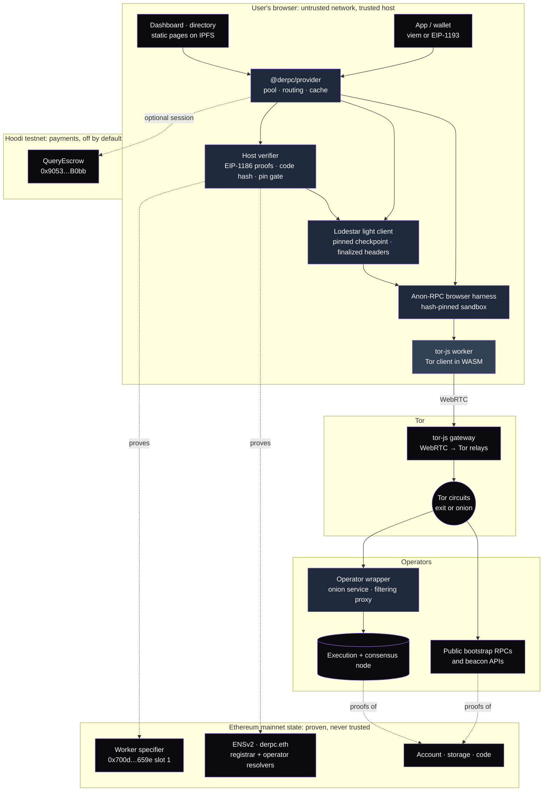
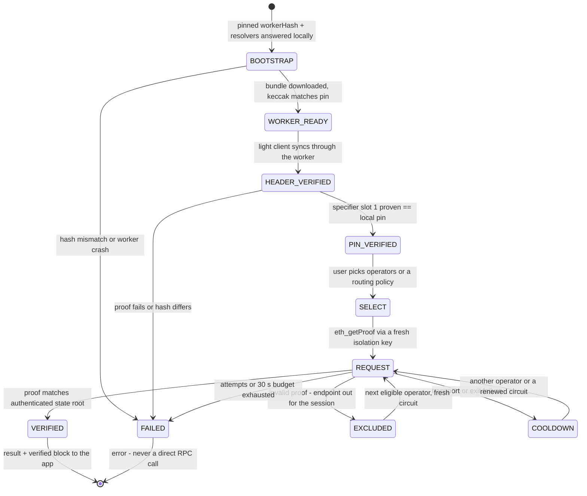
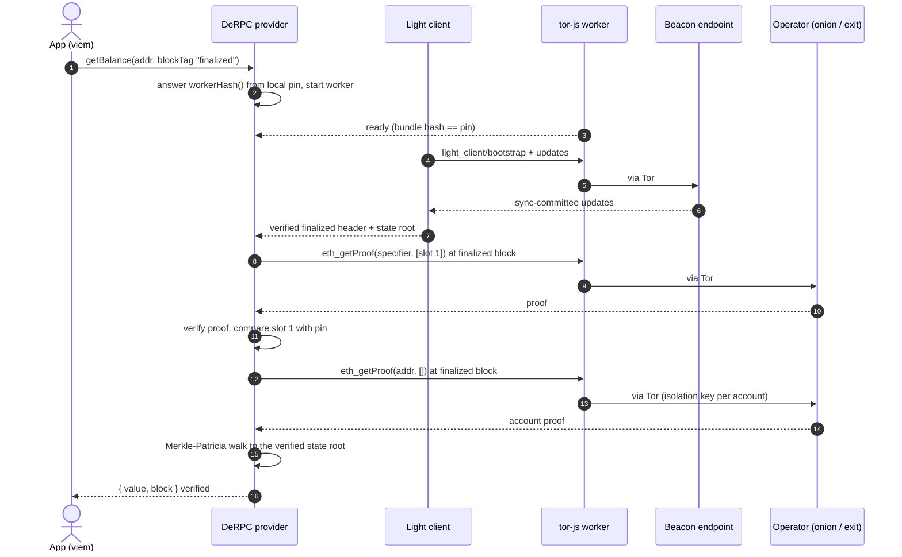
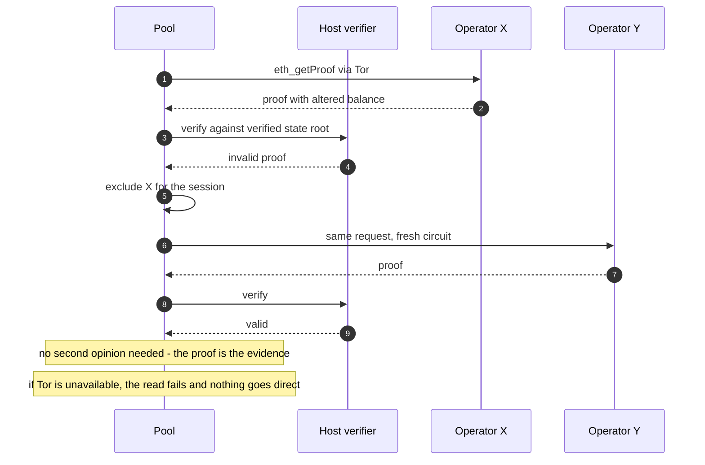

<div align="center">

# DeRPC

**A decentralized RPC pool for private, verified Ethereum reads**

A client-side read provider for apps, wallets and agents. It routes every RPC and beacon request through [Anon-RPC](https://github.com/ethereum/anon-rpc), authenticates the state root with a light client, checks each answer against an EIP-1186 proof, and fails over anonymously inside the operators the user chose. It rejects anything it cannot prove and never falls back to a direct RPC connection.


[Overview](#overview) · [Architecture](#architecture) · [How It Works](#how-it-works) · [Quick Start](#quick-start) · [API](#api) · [Security](#security-model) · [Status](#status-and-validation)

---

</div>

## Table of Contents

- [Submission](#submission)
- [Overview](#overview)
  - [The Problem](#the-problem)
- [Core Features](#core-features)
- [Architecture](#architecture)
- [How It Works](#how-it-works)
  - [Read Lifecycle](#read-lifecycle)
  - [Verified Read Flow](#verified-read-flow)
  - [Rejection and Failover Flow](#rejection-and-failover-flow)
- [Quick Start](#quick-start)
- [Project Structure](#project-structure)
- [API](#api)
- [Environment Variables](#environment-variables)
- [Technology Stack](#technology-stack)
- [Security Model](#security-model)
- [Deployment](#deployment)
- [Status and Validation](#status-and-validation)

---

## Submission

**ETHGlobal Mumbai, November 5–7, 2026** · Targeting the **Ethereum Foundation** Anon-RPC track (primary) and **EF Best CROPS App**, with **ENS Best Use of ENSv2** gated on the operator registry going live.

- **Live demo**: <https://derpc.eth.limo/demo/> (directory at <https://derpc.eth.limo/>, served from IPFS through the `derpc.eth` contenthash)
- **Demo video** (2–3 min, human-narrated): added after recording; see the [submission packet](specs/SUBMISSION_DRAFT.md)
- **Sponsor feedback**: [`FEEDBACK.md`](FEEDBACK.md)
- **AI usage disclosure**: [`AI_USAGE.md`](AI_USAGE.md)
- **Threat model**: [`THREAT_MODEL.md`](THREAT_MODEL.md)

### Team

| Name | Telegram | X |
|---|---|---|
| Robert Lopez | [@n0there](https://t.me/n0there) | [@RobGT0](https://x.com/RobGT0) |
<!-- Add one row per teammate before submission. -->

---

## Overview

DeRPC runs in the browser. A TypeScript provider (`@derpc/provider`, EIP-1193 plus a viem transport) pins the Anon-RPC worker locally, starts a Lodestar light client from a trusted checkpoint, proves the worker pin on-chain, and then serves account, nonce, code and storage reads that are each checked against the authenticated state root. Operators are chosen by the user, manually or through an explicit routing policy, and discovered from a curated bootstrap list or a proven ENSv2 registry under `derpc.eth`. An operator-side wrapper puts a Tor onion service and a filtering proxy in front of any mainnet node.

**Ethereum mainnet reads only; experimental and not ready for production.** The current release target is the **free pool**: reading needs no wallet, deposit or API key. Payments are implemented against a test escrow on Hoodi but stay off by default.

### The Problem

- A few large RPC providers see who is asking (the IP) and what they ask.
- Wallets trust whatever the RPC returns, so a lying node goes unnoticed.
- Anon-RPC hides who is asking, but does not verify that the answer is true.
- Public "decentralized" RPC lists give you more endpoints to trust, not fewer reasons to trust them.
- A hosted privacy router sees everything; privacy and verification have to run on the user's own device.

**DeRPC closes the loop in the client.** The worker that carries traffic is untrusted and hash-pinned; verification lives in the host. Every supported answer is checked against an EIP-1186 proof anchored to a light-client-verified finalized header. A failed proof excludes the endpoint locally and the read moves to another operator over a fresh circuit. If the anonymity network is unavailable, reads fail; nothing goes direct. The pitch line: **you don't need to trust operators for correctness; you only need to limit what they can learn about you.**

---

## Core Features

### Verified Browser Provider

`createDeRPC()` returns an EIP-1193 provider, a reader with proof context and a viem transport. Balance, nonce, code, storage and block number are served only from the light client's verified finalized block, with account/storage proofs and code-hash checks performed in the host. `"latest"` is refused rather than relabelled.

### Anonymous Transport with Local Bootstrap

The Anon-RPC harness normally makes two direct `eth_call`s to read the worker hash. DeRPC answers both from a local pin, downloads the hash-checked tor-js bundle (preferring the gateway's hash-addressed KPS mirror), and then proves the specifier contract's `workerHash` slot through the worker before any user read.

### Light Client Without Leaks

A host-side Lodestar 1.43.0 light client syncs from a pinned checkpoint. All beacon requests go through the worker, including head polling; the Server-Sent Events stream that would leak the user's IP is never opened. A local patch backports Lodestar's finality-validation fix and disables unsafe forced committee updates, with regression tests in the normal suite.

### Operator Selection and Failover

Manual selection, or explicit **Balanced**, **Fastest** and **Reliable** policies with exact allowlists. Selection is operator-first (publishing more URLs does not add weight), accounts stay with the operator that first served them, failover is sequential over a fresh Tor circuit, and invalid proofs exclude an endpoint for the session. Anonymity-network failures renew the route without penalizing the operator.

### ENSv2 Operator Registry

Operators own a subname of `derpc.eth` with their own resolver and a bounded `derpc.endpoints` record (1–8 nodes). The client proves registrar membership from storage proofs and can resolve records through bounded local EVM execution against proven state, with no remote `eth_call`. Open, operator-signed registration with owner moderation is implemented; public enrollment of the first entries is a release gate.

### Operator Wrapper

A Tor v3 onion service in front of a filtering proxy for any execution and consensus client: `eth_getProof`, `eth_getCode`, `eth_chainId`, the four light-client beacon routes and a reciprocal identity document. Docker packaging for Linux x64/ARM64, a setup self-test that checks a finalized proof, an authenticated personal mode, and a labelled demo-proxy mode in front of public nodes.

### Dashboard, Directory and Diagnostics

The demo shows routing policy as cards, grouped operator choices and node observations, verified reads with their block, a simulated corrupt response being rejected and failed over, and fail-closed shutdown. A network-check page records which hosts the browser contacted directly. The directory lists operators with provenance labels and an onboarding page that exports an unsigned configuration draft.

### Test Payments (off by default)

A native-asset prepaid escrow (`QueryEscrow`, deployed on Hoodi), cumulative vouchers signed only after verification, durable wrapper settlement and an app coordinator that issues delegated, capped read authorizations. Paid reads are linkable to the paying account by design; the free pool is the current release.

---

## Architecture



DeRPC supplies the pool, proof verifier, pin gate, transport adapters, provider API, wrapper, contracts and demo. It reuses the Anon-RPC browser harness 0.4.0, tor-js 0.4.4, Lodestar light client 1.43.0 and viem 2.57.8. The full request flow is in [`ARCHITECTURE.md`](ARCHITECTURE.md).

**Trust Boundaries**

| Boundary | Trust Level | Verification |
|---|---|---|
| App → provider | Trusted host code | Shipped application code; no analytics, no keys in the read path |
| Provider → tor-js worker | Untrusted | keccak hash pinned locally, then the specifier's `workerHash` slot proven against verified state |
| Worker → Tor gateway | Sees client IP | Relays encrypted Tor traffic only; cannot read destinations or content |
| Worker → RPC operator | Untrusted | Every supported answer checked against an EIP-1186 proof at the verified finalized block |
| Worker → beacon endpoint | Untrusted | Sync-committee signatures verified from a pinned checkpoint; finality updates validated |
| Provider → ENS directory | Proven | Registrar membership from storage proofs; records via bounded local EVM execution on proven state |
| Operator wrapper → its node | Operator's own | Filtering proxy forwards only whitelisted methods and routes |
| Provider → payment escrow | Opt-in, linkable | Vouchers signed after verification; deposit is the hard on-chain limit |
| Trusted checkpoint | Root of trust | Shown in the UI; startup refuses a checkpoint older than seven days |

---

## How It Works

### Read Lifecycle



### Verified Read Flow



### Rejection and Failover Flow



---

## Quick Start

**Prerequisites**

- Node.js 24
- pnpm 11.22.0 (pinned in `package.json`; `corepack enable` picks it up)
- A modern browser; Firefox and Chromium are the tested ones
- Optional: Docker Compose v2 for the operator wrapper, Linux with `flock` for the durable payment tests

### Run the Demo

```bash
git clone https://github.com/r0bops/DeRPC.git
cd DeRPC
pnpm install
pnpm dev          # http://localhost:5173
```

| Page | What it shows |
|---|---|
| [`/`](http://localhost:5173/) | Operator dashboard: choose a routing policy and operators, inspect local observations, read verified ETH/WETH balances and code, reject a simulated bad response, close the worker. |
| [`/example.html`](http://localhost:5173/example.html) | A small integration using only the public provider API and viem, including an unsupported-method error. |
| [`/network-check.html`](http://localhost:5173/network-check.html) | Transport diagnostics: Tor exit checks, candidate RPC/beacon probes and worker logs. Probes are not verified application reads. |

In the dashboard, pick operators manually or apply Balanced, Fastest or Reliable routing. Wait for the worker, light client and worker-pin check, then run the reads. The corruption control alters a response locally to demonstrate rejection and failover; it is not evidence that a real operator lied. Closing the worker demonstrates failure without direct fallback.

### Run the Directory and Demo Together

```bash
pnpm dev:site     # directory at http://localhost:5174, demo under /demo/
```

### Build the Static Site

Release builds ignore `.env` files and require an explicit public gateway in the shell. The result in `web/dist/` is what gets pinned to IPFS.

```bash
VITE_TOR_GATEWAYS='PUBLIC_IP:PORT:CERTHASH' pnpm build:site
VITE_TOR_GATEWAYS='PUBLIC_IP:PORT:CERTHASH' node scripts/check-release.mjs
pnpm --filter web preview
```

### Gateway and Checkpoint

Development defaults to the tor-js demonstration gateway, whose availability is not guaranteed. To use your own [tor-js gateway](https://github.com/ethereum/tor-js), copy `frontend/.env.example` to `frontend/.env.local` and set `VITE_TOR_GATEWAYS` to comma-separated `ip:port:certhash` addresses. The light client starts from the checkpoint in [`provider/src/config/mainnet.ts`](provider/src/config/mainnet.ts) (dated November 5, 2026); startup rejects checkpoints older than seven days, so refresh the root and epoch together before running an older checkout.

### Tests

```bash
pnpm -r test                        # vitest across every package
pnpm typecheck
pnpm --filter @derpc/contracts compile
```

---

## Project Structure

```
DeRPC/
├── provider/                    # @derpc/provider — the library
│   └── src/
│       ├── api/                 # createDeRPC, EIP-1193 provider, viem transport
│       ├── transport/           # Anon-RPC startup, local bootstrap, fetch/JSON-RPC adapters
│       ├── light-client/        # Verified headers, anonymous beacon polling
│       ├── verify/              # EIP-1186 proofs, verified reads, worker-pin gate
│       ├── pool/                # Operator selection, retries, exclusions, caching
│       ├── discovery/           # ENS membership/record discovery
│       ├── operators/           # Endpoint validation and identity checks
│       ├── execution/           # Bounded local EVM against proven state
│       └── config/mainnet.ts    # Checkpoint, worker pins, bootstrap operators
├── frontend/                    # Demo pages: dashboard, integration example, network check
├── web/                         # Directory, product pages, operator onboarding, design tokens
├── wrapper/                     # Operator onion service + filtering proxy (Docker)
├── payments/                    # Session protocol, delegated budgets, coordinator
├── contracts/
│   ├── src/                     # OperatorRegistrar.sol, QueryEscrow.sol (0.8.30)
│   ├── scripts/                 # ENS deployment planner, lifecycle and wallet tools
│   └── deployments/             # Receipts, manifests and fork evidence
├── scripts/                     # Site assembly, release checks, IPFS packaging/verification
│   └── vps/                     # Gateway/IPFS systemd services, release handler, demo-proxy installer
├── brand/                       # Logo and lockups
├── docs/                        # Design system
├── specs/                       # CONTEXT, ROADMAP, milestones, operations, QA, submission
│   └── prompts/                 # AI conversations and research prompts (verbatim)
├── patches/                     # Lodestar light-client finality/committee guards
├── .github/                     # CI, ENS/IPNS release and wrapper release workflows
├── ARCHITECTURE.md              # Request flow and verification boundaries
├── THREAT_MODEL.md              # Assets, boundaries, controls, evidence gates
├── REPO_LAYOUT.md               # Full file manifest
├── AI_USAGE.md                  # AI assistance transparency log
└── FEEDBACK.md                  # Sponsor DX feedback
```

---

## API

### Provider — `@derpc/provider`

A private workspace package for now, not an npm release. The runnable example is [`frontend/src/example.ts`](frontend/src/example.ts); bundlers need the BLS WASM alias from [`frontend/vite.config.ts`](frontend/vite.config.ts) (`@chainsafe/bls` → `@chainsafe/bls/herumi`).

```ts
import { createDeRPC, MAINNET_OPERATORS } from "@derpc/provider";
import { derpcTransport } from "@derpc/provider/viem";
import { createPublicClient } from "viem";
import { mainnet } from "viem/chains";

const userChoice = ["mevblocker.derpc.eth", "blockrazor.derpc.eth"]; // from the user's selection
const derpc = createDeRPC({
  operators: MAINNET_OPERATORS.filter((op) => userChoice.includes(op.ens)),
});
const client = createPublicClient({ chain: mainnet, transport: derpcTransport(derpc) });

try {
  await derpc.ready;
  const balance = await client.getBalance({
    address: "0xC02aaA39b223FE8D0A0e5C4F27eAD9083C756Cc2",
    blockTag: "finalized", // viem defaults to "latest", which DeRPC refuses
  });
} finally {
  derpc.close();
}
```

Automatic routing instead of a manual pool:

```ts
const derpc = createDeRPC({
  operators: [...MAINNET_OPERATORS],
  selection: "balanced",            // or "fastest" | "reliable"
  allowedOperators: ["mevblocker.derpc.eth", "blockrazor.derpc.eth"], // omit = all eligible, [] = none
});
```

| Member | Behavior |
|---|---|
| `derpc.provider` | EIP-1193 `request`, `on`, `removeListener`; usable without viem. |
| `derpc.ready` | Resolves after the worker and a fresh verified header. State reads also wait for the worker-pin proof. |
| `derpc.reader` | Returns `{ value, block }` so callers can show the verified block; includes token balances for a supplied storage layout. |
| `derpc.setOperators(operators)` | Replaces the pool, cancels in-flight work, carries session exclusions forward. |
| `derpc.setRouting(policy, operators?)` | Atomically switches Manual/Balanced/Fastest/Reliable and the exact allowlist. |
| `derpc.refreshDirectory(options)` | Proven ENS refresh; automatic mode adopts entries only with proven membership and records. Snapshots expire. |
| `derpc.verifiedCall(input)` | Opt-in bounded local EVM execution against proven state. Off by default. |
| `derpc.status()` / `onStatus` / `onPoolEvent` | Transport, light-client, checkpoint, pin and operator state. |
| `derpc.close()` | Aborts pending work and closes the worker; later reads fail. |

The built-in `.derpc.eth` keys of the bootstrap list are legacy selection keys, not registered identities; the UI shows those providers by brand. Automatic adoption from ENS requires both proven membership and proven records.

### Supported Reads

All state reads target the **verified finalized block**, which lags the chain head by roughly 13–19 minutes. No signing, no transaction submission.

| Method | Result and verification |
|---|---|
| `eth_getBalance` | Balance from a verified account proof |
| `eth_getTransactionCount` | Nonce from a verified account proof |
| `eth_getCode` | Bytecode checked against the proven account's code hash |
| `eth_getStorageAt` | Storage value checked against the proven storage root |
| `eth_blockNumber` | The verified finalized block number |
| `eth_chainId`, `net_version`, `eth_accounts` | Local metadata: `"0x1"`, `"1"`, `[]` |
| `eth_call` | Refused by default; `verifiedCalls: { eip1193: true }` enables bounded local execution against proven state |
| Logs, history, gas estimation, writes | Refused, never forwarded |

Block selectors accept omitted, `"finalized"`, or the current verified block by number or hash; `"latest"`, `"pending"` and `"safe"` are refused. Errors: `4200` unsupported method, `-32602` invalid input or selector, `-32002` verified read unavailable, `4900` transport disconnected, `-32603` unexpected; `data.reason` carries the underlying name.

### Operator Wrapper — onion service

| Method | Path | Description | Auth |
|---|---|---|---|
| POST | `/rpc` | `eth_getProof`, `eth_getCode`, `eth_chainId` only; every batch member validated; no `latest`, writes or arbitrary calls | None (session voucher when payments are on) |
| GET | `/eth/v1/beacon/light_client/bootstrap/{root}` | Light-client bootstrap | None |
| GET | `/eth/v1/beacon/light_client/updates` | Committee updates, `start_period` + `count` (1–4) required | None |
| GET | `/eth/v1/beacon/light_client/finality_update` | Latest finality update | None |
| GET | `/eth/v1/beacon/light_client/optimistic_update` | Latest optimistic update | None |
| GET | `/.well-known/derpc.json` | Identity document: ENS name, signer, chain IDs, protocol version, node or `demo-proxy` declaration, `endpointId` | None |
| * | personal onion, port 8788 | Same routes, every request authenticated with the personal token; separate cache and limits | `DERPC_PERSONAL_TOKEN_FILE` |

Defaults: 64 KiB input, 8 requests per batch, 32 storage slots per proof, 15 s deadline, 4 MiB execution and 2 MiB beacon output. Credentials and caller headers are never forwarded upstream.

---

## Environment Variables

### Demo and site builds — shell or `frontend/.env.local`

| Variable | Description | Default |
|---|---|---|
| `VITE_TOR_GATEWAYS` | Comma-separated tor-js gateway KPS addresses, `ip:port:certhash`. Release builds take it from the shell only, require a public address and refuse private ones | demo gateway (dev only) |
| `VITE_ENS_DIRECTORY` | Reviewed mainnet directory pins (registry, registrar, expected subregistry) for proven ENS discovery | unset: ENS discovery off |
| `VITE_ENS_OPERATOR_DEPLOYMENT` | Source-matched public deployment manifest that enables operator wallet actions on the site | unset: no wallet execution |

### Operator wrapper — `wrapper/.env`

| Variable | Description | Default |
|---|---|---|
| `DERPC_ENS_NAME` | Operator name, `<label>.derpc.eth` (label 1–31 chars) | — |
| `DERPC_SIGNER` | Public identity / record-management address | — |
| `DERPC_EXECUTION_URL` | Execution client JSON-RPC, bound to loopback | `http://127.0.0.1:8545` |
| `DERPC_BEACON_URL` | Consensus client REST API with light-client routes | `http://127.0.0.1:5052` |
| `DERPC_ENDPOINT_ID` | Stable node ID when one operator runs several endpoints (free-only) | — |
| `DERPC_DEMO_PROXY` | `true` labels the service `demo-proxy` in front of public upstreams | `false` |
| `DERPC_PERSONAL_TOKEN_FILE` | Owner-only secret enabling the authenticated personal onion | — |
| `DERPC_PAYMENT_CHAIN_ID` | Payment chain (Hoodi `560048` or Sepolia `11155111`) | — |
| `DERPC_PAYMENT_RPC_URL` | Administrative RPC for settlement, outside the read path | — |
| `DERPC_PAYMENT_ESCROW` | Verified `QueryEscrow` address; enables `compose.payments.yaml` | — |
| `DERPC_PRICE_WEI` | Integer price per verified read | — |
| `DERPC_SETTLEMENT_KEY_FILE` | Separate settlement key whose address is the escrow payee | — |
| `DERPC_PAYMENT_CONFIRMATIONS` | Confirmations before a session counts as funded | `2` |

### Release pipeline — GitHub repository / environment `ens-production`

| Variable | Description |
|---|---|
| `DERPC_TOR_GATEWAYS` | Repository variable: the public gateway list compiled into the release |
| `DERPC_PIN_HOST` | `derpc-deploy@host` for the IPFS VPS |
| `DERPC_PIN_KNOWN_HOSTS` | The VPS SSH host-key line, checked out of band |
| `DERPC_PIN_PEER_ID` | IPFS peer ID for the advisory provider listing |
| `DERPC_PIN_SSH_KEY` | Secret: private key for the restricted deploy account (can only run the pin handler) |

---

## Technology Stack

### Client

| Layer | Technology |
|---|---|
| Language | TypeScript 5.9 (strict), ES modules |
| Build | Vite 8 · pnpm 11.22 workspaces |
| Ethereum client | viem 2.57.8 (custom transport over `worker.fetch`) |
| Anonymity | Anon-RPC browser harness 0.4.0 · tor-js 0.4.4 worker (specifier `0x700dA3193D35fA54Cd3fBf29B66f2a2A0385659e`) · own `tor-js-gateway` |
| Consensus | Lodestar light client 1.43.0 (patched) · `@chainsafe/bls` WASM · pinned finalized checkpoint |
| Verification | Own EIP-1186 verifier: strict RLP, Merkle-Patricia walk, account/storage/code checks |
| Local execution | Bounded EVM over proven account, code and storage (opt-in) |
| Fonts and design | Inter Variable · tokens in `web/src/tokens.css` ([design system](docs/design-system.md)) |
| Tests | vitest (1,004 default tests across packages) · headless Firefox/Chromium live checks via puppeteer-core |

### Operator and Infrastructure

| Layer | Technology |
|---|---|
| Wrapper | Node 24 service + Tor v3 onion service, Docker Compose (host networking), Linux x64/ARM64 archives |
| Node support | Reth, Geth, Nethermind, Besu, Erigon · Lighthouse, Lodestar, Nimbus, Prysm (light-client routes required) |
| Hosting | Static site on IPFS (Kubo 0.43.1 on a VPS) · IPNS `k51qzi…k9jhc` · `derpc.eth` contenthash · eth.limo gateway |
| Release | GitHub Actions: CI, commit-bound CAR, restricted SSH pin handler, independent retrieval check, IPNS publish |

### Contracts and Domain

| Layer | Technology |
|---|---|
| Contracts | Solidity 0.8.30 · `OperatorRegistrar` (curated, expiring, 128-slot list) · `QueryEscrow` (prepaid vouchers) |
| Identity | ENSv2 on mainnet under `derpc.eth` · per-operator resolvers · versioned `derpc.endpoints` text record |
| Payments | Native-asset escrow on Hoodi `0x9053513aCA73bAc0aF6a9942fd93832fd313B0bb` · EIP-712-style cumulative vouchers · delegated app budgets |
| Chains | Ethereum mainnet (1) for reads, ENS and the worker specifier · Hoodi (560048) for test payments |

---

## Security Model

Correctness relies on the trusted checkpoint, light-client consensus assumptions, the host verifier and the shipped application code. A bundle hash identifies worker code; it does not prove the worker provides anonymity. Target claim: **reads routed anonymously, supported answers verified, query content visible to the node.** The standalone [threat model](THREAT_MODEL.md) records assets, boundaries, controls and remaining evidence gates.

### Key Security Properties

| Property | Implementation |
|---|---|
| Fail closed | No direct RPC or beacon fallback anywhere; transport failure means the read fails |
| Verification in the host | Proofs, code hashes and the pin check never run in the untrusted worker |
| Pinned bootstrap | Worker hash and resolvers answered locally; the on-chain hash is then proven through the worker before user reads |
| Authenticated state root | Light client from a pinned checkpoint; finality updates validated (backported fix), forced committee updates disabled |
| Freshness | Headers older than 30 minutes are rejected when accessed and again before a pending verified read returns |
| Local exclusion | An invalid proof excludes the endpoint for the session; transient failures get a cooldown and a fresh circuit |
| Operator-first weighting | Several endpoints under one operator add redundancy, never selection weight |
| Bounded calls | `eth_call` refused by default; local execution only against proven state with explicit opt-in |
| No key in the worker | The read path has no signer; optional payments keep a disposable session key in the host, capped by the deposit |
| Proven directory | ENS membership and records are proven, time-limited snapshots; unproven directory data never enters the read pool |

### Attack Resistance

| Attack Vector | Status | Mechanism |
|---|---|---|
| Lying RPC node | ✅ Mitigated | EIP-1186 proof against the verified state root; rejected and excluded locally |
| Fake finalized header from a beacon endpoint | ✅ Mitigated | Sync-committee verification plus the backported finality-update guard |
| Tampered worker bundle | ✅ Mitigated | keccak pin, then the specifier slot proven on-chain through the worker |
| Direct-RPC downgrade | ✅ Mitigated | No fallback path exists; shutdown refuses every later read |
| Stale state presented as current | ✅ Mitigated | `"latest"` refused; verified block returned with every read; 30-minute freshness limit |
| Endpoint sees the user's IP | ✅ Mitigated | Tor exit or onion connection; the gateway sees the IP but not destinations or content |
| Operator learns query content | ❌ Not addressed | Inherent to RPC; Tor hides the source, not the question. PIR is roadmap research |
| Linking two accounts of one user | ⚠️ Partial | One isolation key per account; depends on the worker's circuit isolation, observed but unproven |
| Gateway + operator run by the same party | ⚠️ Partial | Declared pairings refused; undisclosed common ownership remains unknown |
| Censorship or downtime by an operator | ⚠️ Partial | Routed around locally; cannot be proven, so never slashed |
| Sybil operators in the ENS registry | ❌ Not addressed | Open free admission; owner moderation and address blocks only. Staking is later work |
| Specifier owner changes the worker hash | ⚠️ Partial | A finalized change no longer matching the pin stops reads; a person reviews and re-pins |
| Compromised payment session key | ✅ Mitigated | Non-spending read authorization; the escrow deposit is the hard limit |
| Supply chain of the light client | ⚠️ Partial | Exact pins and a reviewed patch; Lodestar's light client is unmaintained upstream |

### Traffic and Exposure

| Traffic | Route and exposure |
|---|---|
| Execution reads, proofs and code | Worker → Tor → exit or onion. Operators see query content |
| Beacon bootstrap and updates | Worker → Tor. The beacon endpoint sees those requests |
| ENS discovery and identity checks | Worker → Tor; identity and pin-proof requests only, no account queries |
| Harness bootstrap calls | Answered locally from the pin; no network request |
| Worker bundle download | Gateway KPS mirror first, then declared HTTPS resolvers; hash-checked either way |
| Tor gateway connection | Direct over WebRTC; the gateway sees the client's IP |
| Page assets | Direct from the IPFS gateway or page host |
| Wallet deposits, refunds, operator settlement | Outside the worker, through the wallet's or operator's own RPC; never a read fallback |

### CROPS

- **C — Censorship resistance:** a static app with local selection and verification; no required DeRPC proxy. Operators and gateways are replaceable, but unavailable routes still cause reads to fail.
- **O — Open source:** MIT, buildable from this repo with public dependencies. Free reads need network access and a recent checkpoint, no account or API key.
- **P — Privacy:** RPC and beacon traffic uses Tor by default. Queries remain visible to endpoints; the gateway, bundle resolver and page host see the connections above. No analytics; no account-unlinkability claim.
- **S — Security:** the read provider exposes no signing or transaction submission; host-side verification checks supported answers against authenticated state. Experimental contracts and open release gates limit production use.

---

## Deployment

### Site → IPFS + ENS (GitHub Actions)

Every push to `main` runs the [CI](.github/workflows/ci.yml) and the [IPNS release](.github/workflows/release-ens.yml): checked build, commit-bound CAR, offline validation, pin on the VPS through a restricted SSH command, independent retrieval check, then publication of the fixed IPNS name that `derpc.eth`'s contenthash already points to. No Ethereum transaction is sent by the pipeline. Manual runs can package only.

```bash
# one-time: configure the variables and secret from the Environment Variables section, then
gh workflow run release-ens.yml
# local equivalents
VITE_TOR_GATEWAYS='PUBLIC_IP:PORT:CERTHASH' pnpm build:site
node scripts/package-ipfs.mjs            # CAR, root CID, ENSIP-7 contenthash, manifest
node scripts/verify-ipfs.mjs --dir ...   # compare a pinned release with its manifest
```

Runbooks: [`web/README.md`](web/README.md#ensipfs-deployment), [`scripts/vps/GITHUB_RELEASE.md`](scripts/vps/GITHUB_RELEASE.md), [`scripts/vps/IPNS.md`](scripts/vps/IPNS.md).

### Operator → Docker wrapper

```bash
# on a Linux host with synced execution + consensus nodes bound to 127.0.0.1
export DERPC_ENS_NAME=alice.derpc.eth
export DERPC_SIGNER=0xYourPublicSigner
export DERPC_EXECUTION_URL=http://127.0.0.1:8545
export DERPC_BEACON_URL=http://127.0.0.1:5052
pnpm --filter @derpc/wrapper run setup   # builds, starts, self-tests a finalized proof, prints the records to publish
```

Prebuilt Linux x64/ARM64 archives are published by the [wrapper release workflow](.github/workflows/release-wrapper.yml); see the [wrapper runbook](wrapper/README.md). A team-run demonstration proxy in front of public nodes installs with [`scripts/vps/install-demo-proxy.sh`](scripts/vps/install-demo-proxy.sh) and labels itself `demo-proxy`.

### Contracts → mainnet ENS and Hoodi escrow

```bash
pnpm --filter @derpc/contracts compile
pnpm --filter @derpc/contracts test
# unsigned ENS deployment plans, receipt verification and lifecycle tools:
node contracts/scripts/ens-wallet.mjs --help
```

The [contract guide](contracts/README.md) covers the registrar deployment stages (owner-signed in a browser wallet, receipts verified through two sources at twelve confirmations) and the test-escrow deployment. Public ENS enrollment of the first operators is still pending.

---

## Status and Validation

As of **November 7, 2026**, the provider, dashboard, directory, wrapper, contracts and payment modules are implemented and the free mainnet alpha is live at `derpc.eth.limo`. The November 6 default workspace run passed **1,004 tests** (65 contracts, 68 payments, 576 provider, 58 wrapper, 237 frontend), plus five opt-in ENS fork tests, workspace type checking, the combined static-site build and the offline release check. Details and dates are in the [QA report](specs/QA_REPORT.md).

| Evidence | What was observed |
|---|---|
| [Hosted Firefox checks](frontend/test/ipns-hosted-firefox-evidence-2026-11-06.json) | Fresh browser on the real ENS/IPNS site: verified reads, no direct RPC/beacon HTTP requests, refusal after shutdown |
| [Public-gateway cold start](provider/test/light-client/period-1904-integration-evidence-2026-11-06.json) | Pin and balance verified at finalized block 26358539 through the public VPS gateway across a sync-committee period boundary |
| [Five-endpoint roster](provider/test/fixtures/automatic-roster-live-2026-11-06.json) · [Automatic routing](provider/test/fixtures/automatic-routing-live-2026-11-06.json) | All configured public endpoints returned verified reads through Tor; Balanced/Fastest/Reliable, affinity, empty-list refusal and exact allowlists at blocks 26356307–26356339 |
| [Onion and local execution](wrapper/test/live-evidence-2026-11-06.json) · [Sibling failover](wrapper/test/multiendpoint-evidence-2026-11-06.json) | Real pinned-worker onion reads, host-side ENSv2 resolver execution, forced failure recovered through a sibling endpoint. Gateway and proxies run by the same tester |
| [Gateway bundle delivery](provider/test/transport/kps-bootstrap-live-2026-11-06.json) · [Live site check](frontend/test/public-gateway-limo-evidence-2026-11-06.json) | Hash-checked worker loaded through the gateway mirror with zero CDN requests, locally and on `derpc.eth.limo` |
| [ENS fork checks](contracts/deployments/ens-fork-evidence.json) · [Open registration](contracts/deployments/ens-open-registration-validation-2026-11-07.json) | Real ENS bytecode on a mainnet fork: permissions, deployment verification, independent operator joining while the curator is idle |
| [Hoodi escrow](contracts/deployments/payment-hoodi-deployment-2026-11-06.json) · [Container payment lifecycle](wrapper/test/payment-container-evidence-2026-11-06.json) | Public test deployment checked through two sources; local-chain paid reads, restart recovery, settlement and refunds |

These are dated functional observations, not uptime guarantees, latency benchmarks or an independent security audit.

| Area | Remaining work |
|---|---|
| Free public release | Keep gateway/onion availability and a recent checkpoint (refresh before Nov 12, 17:07 UTC); observe a full IPNS renewal cycle; redundant pinning |
| ENS lifecycle (M1-A) | Owner-signed deployment of the registrar and the first `demo-1`/`demo-2` entries; proven discovery after a finalized refresh; independent operators to replace team-run proxies |
| Multiple endpoints (M1-B) | Public enrollment of a plural record and finalized directory changes observed by the client |
| Payments | Public funding/read/settlement/refund cycle on Hoodi, a deployed app coordinator, external readiness reviews |
| Later economics | Operator identity stake, traffic-dependent per-node stake, accountability rules; staking never replaces proofs |

Additional EVM chains need their own authenticated headers, proof and finality rules and tested endpoints. Nym has a pin in the configuration but has not been validated as a runtime here. This prototype has not had an independent security audit.

---

<div align="center">

**Built for ETHGlobal Mumbai — reads routed anonymously, answers proven, never a direct fallback.**

[MIT License](LICENSE)

</div>
