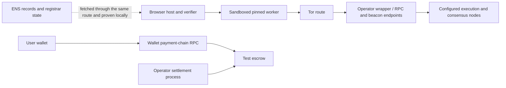

# DeRPC threat model

Working-tree model, November 6, 2026. This describes the browser provider, ENS discovery, operator wrapper and optional test-payment system. It does not constitute an independent security audit. Product scope and deferred deployment gates remain in [CONTEXT.md](specs/CONTEXT.md) and [OPERATIONS.md](specs/OPERATIONS.md).

## Security claim and scope

DeRPC routes execution and consensus requests through the pinned Anon-RPC worker and verifies supported mainnet reads in the host. It refuses an answer when its proof, authenticated context, authorization or freshness checks fail. No failure path substitutes direct RPC.

The supported guarantees are narrower than a general wallet RPC: finalized balance, nonce, code, storage and block number, plus explicitly enabled bounded local EVM execution. Remote `eth_call` results are never accepted as verified application answers. Unsupported chains, methods, execution context and off-chain resolver fetches are refused.

Tor aims to hide the caller's IP from the RPC endpoint. **The endpoint still sees methods, addresses, parameters and timing.** This system does not prove that an operator is honest, keeps no logs, owns its upstream node, or will remain available. ENS registration, a matching identity document, several URLs and a future stake do not establish those properties.

## Assets, principals and trust boundaries

| Asset or principal | Trusted for | Limit |
|---|---|---|
| Browser host and shipped application | Verification, routing authorization, checkpoint/pin configuration and protection of host-held credentials | A compromised application, extension or device can change queries, disclose data or misuse host keys. Worker isolation does not protect against a malicious host. |
| Website ENS authorities and IPNS publishing key | Selecting the application code visitors download | With the ENS-to-IPNS switch confirmed, the VPS publishing key can change the application and verifier without another Ethereum signature. Its encrypted backup passed restoration; key compromise still permits malicious releases. ENS owner and existing resolver administrators retain authority over the pointer. See the [publishing runbook](scripts/vps/IPNS.md). |
| Trusted checkpoint and Ethereum consensus | Authenticating finalized execution headers and state roots | A checkpoint is an explicit trust input. Consensus assumptions, BLS/SSZ implementations and the light-client patch remain security dependencies. |
| Anon-RPC harness | Bundle integrity and isolation from DOM, cookies, host storage and signing keys | The worker is untrusted; a correct bundle hash identifies code but does not certify its privacy behavior. |
| Tor worker, gateway and relays | Providing the configured anonymous route | They can delay, deny, observe or correlate traffic. A global observer or colluding participants may defeat anonymity. |
| RPC/beacon endpoint and wrapper | Availability of bytes to verify | Their claimed roots, results, capabilities, prices and identities are not trusted merely because transport succeeded. |
| ENS parent owner and registrar curator | Directory governance and admission | The parent can repoint its subregistry; the curator admits and delists operators. This is curated discovery. |
| Operator resolver cold owner and hot key | Their granted record-update scope | The cold owner controls broader text permissions; the hot key is limited to the configured endpoint record. Neither key proves service quality. |
| Payment wallet, session signer and app coordinator | Explicitly authorized test spending and durable accounting | A stolen escrow signing key can authorize spending up to the on-chain deposit. Client-side limits alone cannot constrain a compromised signer. |

The payment and administrative paths in this diagram are separate from the verified read transport. They cannot serve as read fallbacks.

GitHub website automation gives the restricted deployment credential and authorized
`main` workflow the ability to publish new application code through the VPS's fixed
IPNS key. The key stays on the VPS, but that separation does not remove the workflow's
publishing authority. The environment is restricted to `main`; CAR validation,
commit binding, durable release ordering and independent signed-record/HTTPS checks
guard deployment mistakes. They cannot make a deliberately malicious authorized
release safe. See [release operations](scripts/vps/GITHUB_RELEASE.md).

## Threats and controls

| Threat | Implemented control | Residual risk or completion gate |
|---|---|---|
| RPC invents a balance, code or storage value | Host verifies account/storage proofs against authenticated state roots and checks code hashes; block/address/slot bindings are validated | Verifier or host defects remain possible. Agreement between endpoints is not a proof. |
| Beacon endpoint supplies a false or stale chain | Pinned checkpoint, signature-verified updates, authenticated execution payloads, startup epoch binding and freshness checks | Checkpoint choice and consensus assumptions remain trusted. The [period-1904 cold start](provider/test/light-client/period-1904-evidence-2026-11-06.json) passed through the local gateway; public-hosted acceptance and checkpoint expiry remain separate. |
| Worker changes responses or destination | Host performs verification, pin checks and reciprocal endpoint identity checks; invalid proofs lead to local exclusion | The worker can censor or observe requests. Unsigned responses do not prove that an operator, rather than the worker, tampered. |
| Worker bundle is replaced | Bundle hash is pinned locally, checked by the harness and proven against the on-chain specifier before user reads | The specifier owner can publish an update; DeRPC refuses a mismatching pin. A matching malicious bundle still threatens privacy. |
| Directory data redirects account queries | Automatic ENS adoption requires proven membership and records at one authenticated snapshot, valid capabilities, identity matching and a public proof probe | Parent/curator authority remains; private reads reveal their contents to the authorized endpoint. A direct explicit endpoint choice has different provenance. |
| A removed or rotated operator remains usable indefinitely | Listing expiry and bounded directory-snapshot validity, with explicit verified refresh; endpoint rotation invalidates old identity/health evidence | Finality and refresh delay mean revocation is not instantaneous. A submitted transaction alone does not change the finalized client view. |
| Routing changes broaden access or activate payment mid-request | Explicit automatic opt-in, exact allowlists, empty-list refusal, atomic changes and request-entry cancellation boundaries | Changing the user's authorized operator set can expose later queries to a different operator. The host application controls that consent flow. |
| Speed claims or many URLs bias routing | Operator-first selection, at most 32 recent actual outcomes per group, proof verification before successful measurements, per-account affinity and sequential attempts | Local speed is not global uptime or honesty. Multiple ENS identities can still represent one owner; curated admission does not prove independence. |
| A malicious client uses the wrapper as an unrestricted proxy | Fixed upstream configuration, method/path/body/batch/key/concurrency limits, explicit block selectors and timeouts | Tor connection work and permitted queries still consume resources. Current caps do not establish general denial-of-service resistance. |
| Private node or session credentials leak | Personal endpoint/token and browser session signer remain in host memory; private UI/log surfaces are redacted; personal mode has a separate authenticated onion | A compromised host or endpoint can expose them. Operators must protect backups, settlement keys and runtime configuration. |
| Payment replay, duplicate spend or crash rollback | Exact session/read intents, capped durable reservations, cumulative vouchers after verification, frozen session terms and single-writer settlement journals | Public paid-session/settlement evidence and independent review remain required. Multi-wrapper shared-session accounting is not implemented. |
| An outage triggers a privacy downgrade | Transport/header failure and shutdown terminate reads; bounded retries remain inside the authorized anonymous pool | Availability is intentionally lost when no valid anonymous route remains. |

## State and authorization lifetimes

The default checkpoint maximum age is seven days. The resolved bootstrap epoch is checked against the configured epoch. Finalized headers have a default maximum age of 30 minutes and are rechecked before returning results, including after asynchronous payment signing. These limits do not make finalized data equivalent to `latest`.

Proven ENS directory snapshots have a separate lifetime: ten minutes after first accepting the authenticated snapshot, capped at 30 minutes after its block timestamp. Monotonic elapsed time and clock-rollback checks prevent extending an accepted snapshot by moving the wall clock backwards. A failed refresh, a strategy change, local reselection or another scan of the same block does not renew that authorization. An expired snapshot requires a newer proven snapshot or removal of its dependent entries from the selected pool. Administrative recovery must not reopen user reads through retained bootstrap endpoints. Settling an existing funded session remains possible after directory/listing expiry. Legacy unverified discovery is a separate, explicitly labeled mode and cannot satisfy this verified-directory guarantee.

Local invalid-proof exclusions survive routing changes for the session. Observations are local evidence and are bounded in time and count. Account affinity limits unnecessary redistribution, but failover can reveal the same account to another operator. Isolation keys express an intention to separate accounts; account unlinkability is not claimed for the deployed worker.

Current automatic selection is free-only. It cannot silently activate a previously funded payment session. Plural endpoint records separate stable operator identity from node ID and destination. They are bounded to eight endpoints and 4096 UTF-8 bytes, reject invalid records without legacy fallback, and require the wrapper's node ID to match. Group aliases cannot create extra selection weight. Rotation clears old destination observations without clearing the session's rejection evidence for that old URL. Plural/multi-node payment configurations are refused: existing funded sessions remain tied to a single settlement destination. Public multi-endpoint enrollment and lifecycle evidence remain [M1](specs/ENS_TOR_MILESTONE.md) gates.

The plural resolver permission controls the entire endpoint list, including its beacon URLs. It is not a per-node permission. A cold-owner-reviewed migration replaces the old singular permission; broader resolver and curator authorities remain separate. Imported lifecycle receipts are administrative observations only. The dashboard compares their expected fields with a fresh proven directory and does not infer receipt inclusion, canonical ancestry or transaction causality from that comparison.

## Data visible outside the host

| Recipient | Information it can observe |
|---|---|
| Page host and worker bundle CDN | Client IP, asset requests, and related timing. Bundle acquisition precedes the anonymous worker. |
| Tor gateway | Client connection and encrypted Tor traffic timing/volume. It is not an RPC verifier. |
| RPC endpoint or operator proxy | Query contents and timing; a proxy's upstream receives forwarded queries. Exit-based HTTPS and onion transport protect different network segments. |
| ENS/discovery endpoint | Public registry/record requests. Candidate probes use the same public fixture, not the user's account addresses. |
| Payment operator and coordinator | Session/read identifiers, vouchers and sponsored-query evidence. Paid queries are linkable to their funded session and payer. |
| Wallet RPC and public chain | Wallet transactions; the RPC can observe wallet connection metadata, and chain records disclose transaction fields. |

Known same-owner gateway/RPC pairings are refused when declared or independently configured. Unknown common ownership cannot be inferred from addresses. Same-party local gateway/proxy demonstrations are explicitly limited evidence. A browser resource-timing table alone is not a full audit of WebRTC or every network surface.

## Payment and operator-key limits

The escrow is a separate query-payment mechanism, not operator staking. Staking, fees for registration, traffic-based collateral and slashing remain unimplemented economic policy. Payments default off in the free demo and tooling is restricted to test chains. Mainnet reads do not imply that Hoodi payment receipts are light-client verified.

The host signs cumulative payment only after its verification and freshness checks pass. Once signing/completion begins, failure is terminal for that read to avoid paying another operator through a retry. Delegate keys authorize bounded requests to a trusted coordinator, not direct escrow withdrawals; the coordinator retains escrow signing capability and verifies completion independently. Durable storage and its authenticated administration are part of that trust boundary.

Session destinations and prices remain pinned. Operator identity alone does not authorize moving a funded session to a new wrapper. Restoring an old payment journal can lose knowledge of signed or reserved exposure; a successful onion-key backup restore does not establish safe funded-ledger rollback.

## Evidence and unresolved gates

Behavioral regression evidence lives in [provider tests](provider/test/), [wrapper tests](wrapper/test/), [payment tests](payments/test/) and [contract tests](contracts/test/). The light-client attack, forced-update and lifecycle tests are distinct from an independent consensus review. ENS fork tests use actual contract bytecode but injected local/fork state; they do not prove a public deployment or a live consensus-verified registry.

The dated [automatic-routing evidence](provider/test/fixtures/automatic-routing-live-2026-11-06.json) and [wrapper evidence](wrapper/test/live-evidence-2026-11-06.json) state their source versions, route and limits. Tests and receipts should be interpreted only at that scope; later code changes require relevant checks again.

The full goal remains incomplete while public independent ENS operators and finalized lifecycle evidence, the reliable hosted/public anonymous path, the paid funding/read/settlement/refund demonstration, app-coordinator deployment, or required independent/legal reviews are missing. Multi-endpoint identities also remain an explicit product milestone. The current requirement-by-requirement gates are maintained in [OPERATIONS.md](specs/OPERATIONS.md), [ROADMAP.md](specs/ROADMAP.md) and [ENS_TOR_MILESTONE.md](specs/ENS_TOR_MILESTONE.md).
