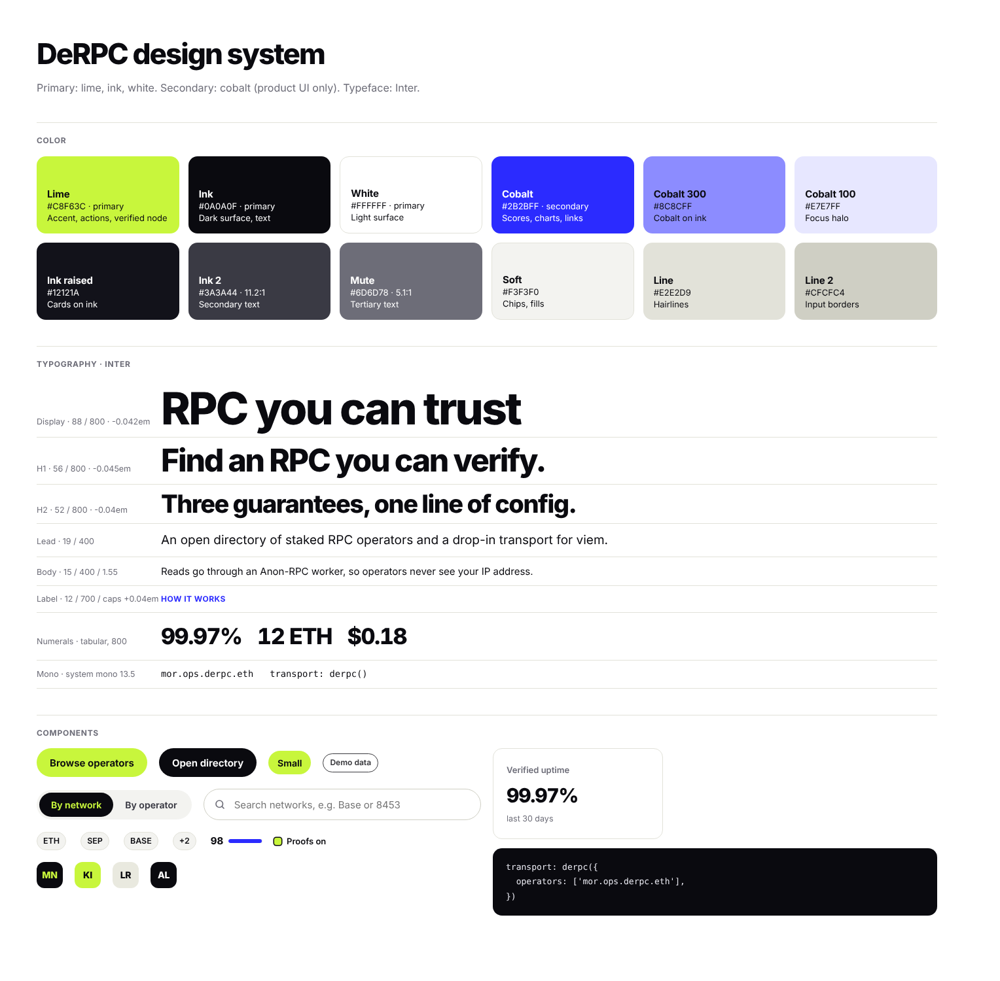
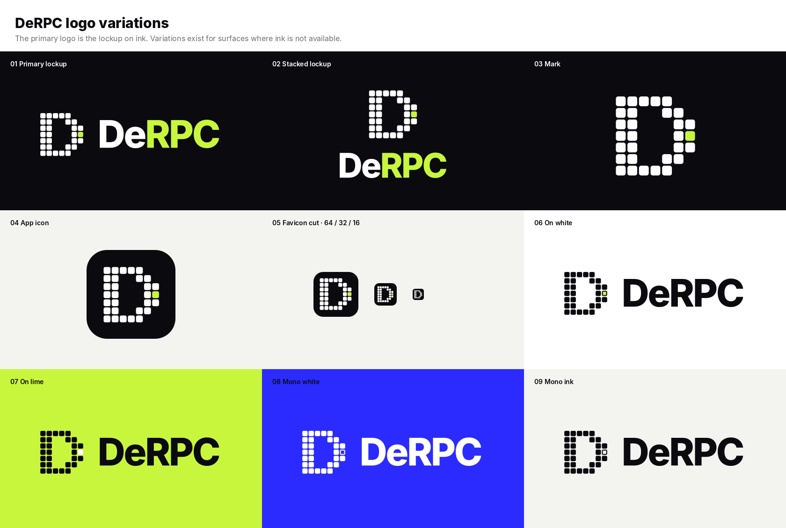
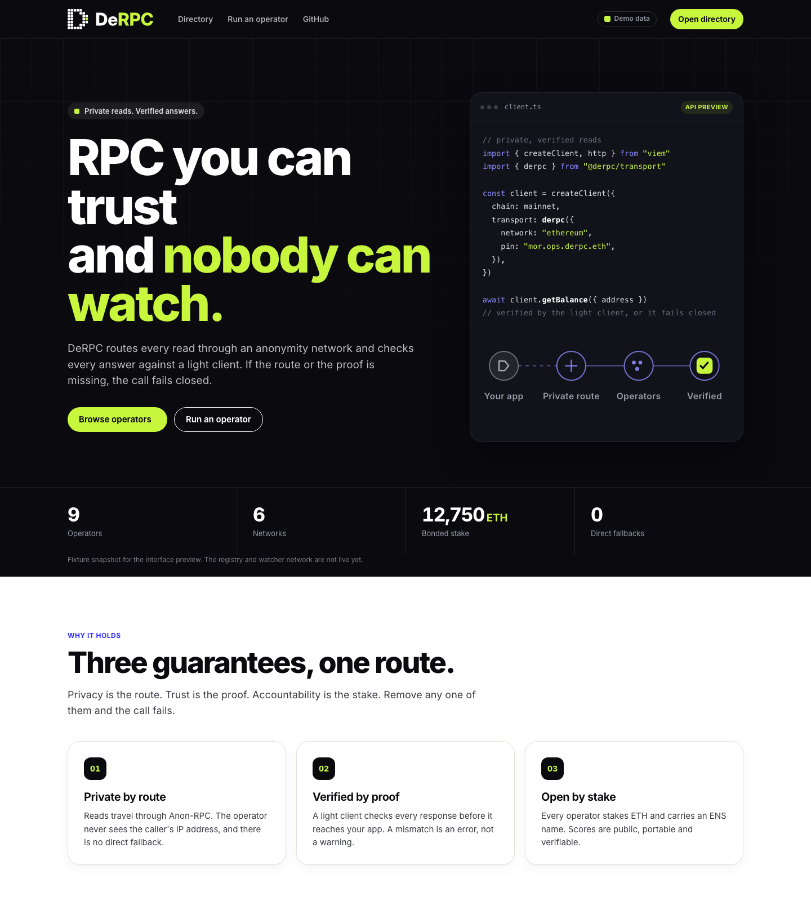
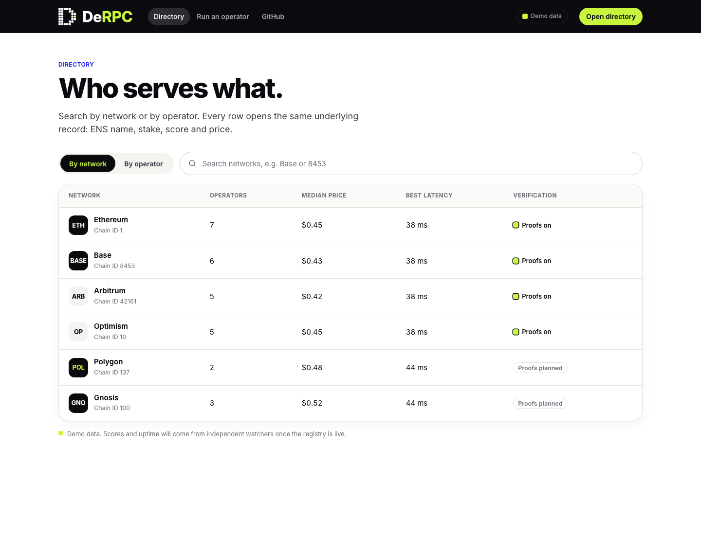
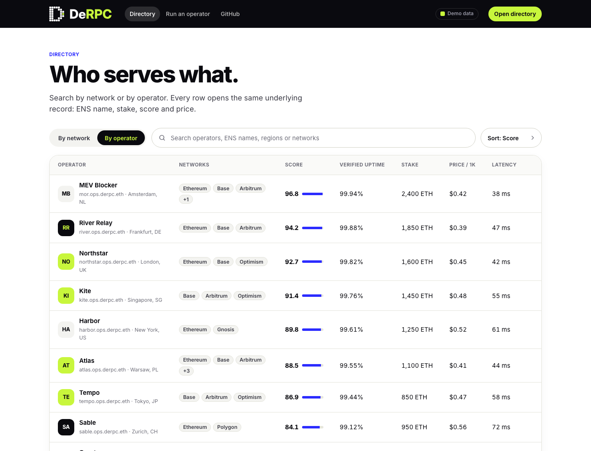
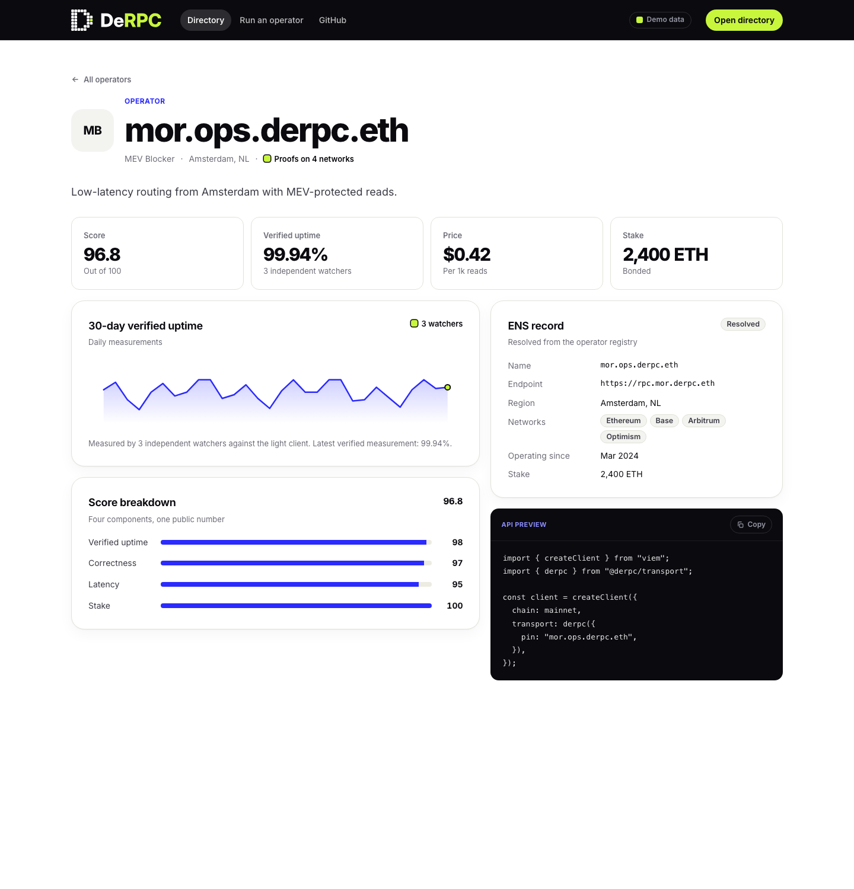
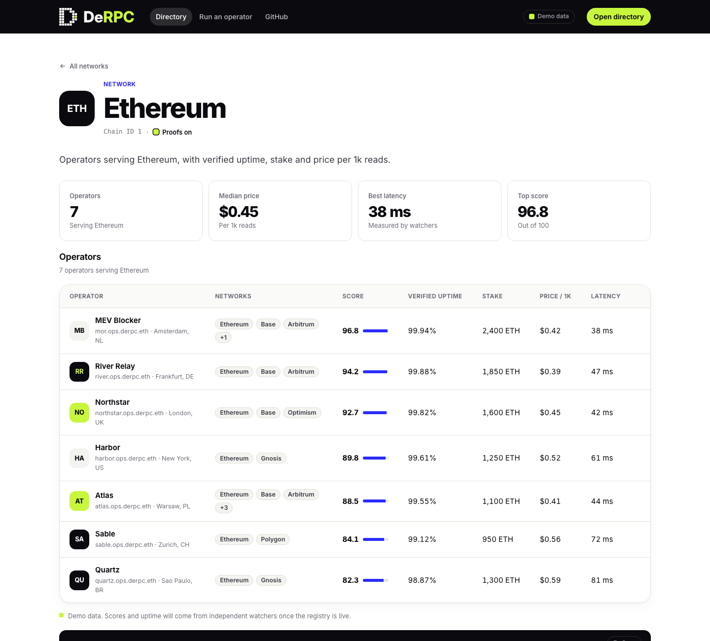
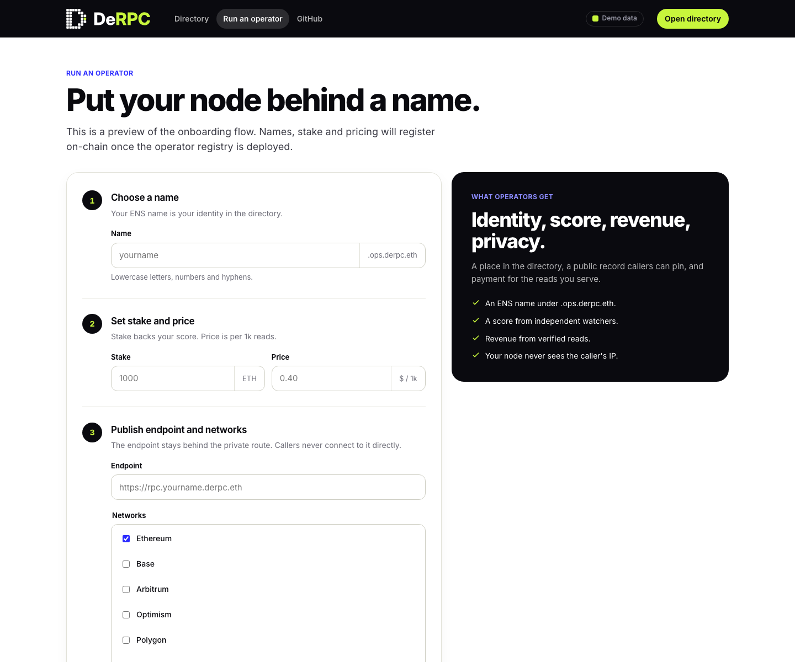

# DeRPC Design System

**Version 0.2 · Draft for ETHGlobal Mumbai 2026**

This document defines how DeRPC looks, reads and behaves: the brand, the tokens, the components, the front end and the people it is built for. It is the reference for anyone adding a page, a component or a piece of copy. The code that implements it lives in [`web/`](../web) (tokens in [`web/src/tokens.css`](../web/src/tokens.css)) and the logo files in [`brand/`](../brand).



## Contents

1. [Product context](#1-product-context)
2. [Design principles](#2-design-principles)
3. [Brand](#3-brand)
4. [Logo](#4-logo)
5. [Color](#5-color)
6. [Typography](#6-typography)
7. [Layout, space, shape and elevation](#7-layout-space-shape-and-elevation)
8. [Imagery and iconography](#8-imagery-and-iconography)
9. [Components](#9-components)
10. [Motion and interaction](#10-motion-and-interaction)
11. [Accessibility](#11-accessibility)
12. [Content and voice](#12-content-and-voice)
13. [The front end](#13-the-front-end)
14. [Users](#14-users)
15. [Implementation status](#15-implementation-status)
16. [Governance](#16-governance)

---

## 1. Product context

DeRPC is Ethereum developer infrastructure with two parts:

- **A provider.** A client-side library for viem (`createDeRPC` plus `derpcTransport`, package `@derpc/provider`). Reads travel through an anonymity network (Anon-RPC), so the operator does not see the caller's IP address, and every answer is checked against a proof from a light client. If no private route or no proof is available, the call fails. It never falls back to a direct request. Today this works on Ethereum mainnet only, for finalized state; it is not a drop-in for every RPC method.
- **A directory and dashboard.** The directory lists operators and their documented networks; the live dashboard shows local observations from user-selected operators. Only supported finalized Ethereum mainnet reads are verified. Other networks are labeled "not verified". ENS names in the bootstrap directory are mock. The free onboarding flow prepares a draft for one operator identity and several node endpoints; multi-endpoint runtime support, public registration, staking and operator pricing remain later implementation/deployment work. See [DEMO_WORKFLOW.md](../specs/DEMO_WORKFLOW.md).

Health, identity and response correctness use separate labels. Unobserved endpoints are unknown; historical proof success never certifies future behavior. Stakes and independent watcher scores must not be invented. The requested later stake requirement changes per node with network traffic; no formula or amount is chosen. Tor aims to hide the caller's IP from the RPC endpoint, while query contents remain visible to it.

The design problem is **trust**. The product asks developers to route their users' reads through a stranger's node, and to believe that the answer is correct. The interface has to make privacy, verification and accountability legible at a glance, without sounding like marketing.

## 2. Design principles

1. **Show proof, not promises.** Every claim the product makes (verified, private, served) is backed by something the user can see: a proof indicator or a source link. Where something is not real yet, the interface says so.
2. **Verified is rare, so it is loud.** Lime marks the verified node and nothing else that means "checked". When lime appears, something was proven.
3. **Infrastructure, not a wallet.** The tone is precise and calm: dense tables, tabular numerals, code snippets. No gradients, mascots, coins, or locks.
4. **Fail closed, in design as in code.** Empty and error states say what happened and what DeRPC refused to do. They never suggest an unsafe workaround.
5. **Two ways in, one model.** People search by network ("who serves Base?") or by operator ("what does this operator run?"). Both views share the same chips and vocabulary.
6. **Small, fast, hostable anywhere.** No framework, hash routing, self-hosted font. The site must load from IPFS and `derpc.eth.limo`.

## 3. Brand

| | |
| --- | --- |
| **Name** | DeRPC. Always written exactly like this: capital D, lowercase e, capitals RPC. Never "Derpc", "DERPC" or "De-RPC". |
| **Reading** | "De" for decentralized, "RPC" for the interface developers already use. |
| **Descriptor** | Private, verified RPC for Ethereum. |
| **Personality** | Precise, calm, confident, a little dry. Engineering-first. |
| **Typeface** | Inter. |
| **Colors** | Primary: lime, ink, white. Secondary: cobalt. |

## 4. Logo

### Concept

The mark is a **pixel D**. It is built on a 7 × 7 grid of rounded squares. **One lime pixel on the bowl is the verified node**: the point where a private route ends in an answer that has been proven. The pixel grid also gives the brand its pattern (the faint 56 px grid behind the hero).

The primary logo is the **lockup on ink**: white pixels, a lime node, "De" in white and "RPC" in lime, set in Inter ExtraBold.

### Variations



| # | Variation | File | Use it for |
| --- | --- | --- | --- |
| 01 | **Primary lockup** | `brand/derpc-lockup.svg` (transparent), `derpc-lockup-on-ink.svg` (with background) | Default. Site navigation, footer, slides, video titles, README header. Always on ink or another very dark surface. |
| 02 | **Stacked lockup** | `brand/derpc-lockup-stacked.svg` | Square or narrow spaces: social cards, posters, loading screens. |
| 03 | **Mark** | `brand/derpc-mark.svg` | When the name is already visible nearby: avatars, section markers. |
| 04 | **App icon** | `brand/derpc-app-icon.svg`, `derpc-logo-512.png`, `derpc-logo-1024.png` | App icon, social avatar, the 512 × 512 project logo for hackathon and directory submissions. |
| 05 | **Favicon cut** | `brand/derpc-favicon.svg` | 16 to 64 px. Pixels are enlarged and spaced so the D stays readable. |
| 06 | **On white** | `brand/derpc-lockup-on-white.svg`, `derpc-mark-on-white.svg` | Documents, white pages and print where ink is not available. Pixels and wordmark in ink; the node stays lime, with a 4 px ink outline so it remains visible. |
| 07 | **On lime** | `brand/derpc-lockup-on-lime.svg` | Lime panels and stickers. Everything in ink; the node turns white. |
| 08 | **Mono white** | `brand/derpc-lockup-mono-white.svg` | One-color use on photos, cobalt or other colored fields. The node becomes a hollow square. |
| 09 | **Mono ink** | `brand/derpc-lockup-mono-ink.svg` | One-color use on light fields, stamps, single-ink print. The node becomes a hollow square. |

The primary lockup is the logo. Variations 06 to 09 exist only for surfaces where the primary cannot be used. Prefer the primary whenever the surface can be dark.

### Clear space

Keep an empty margin of at least **1p** on every side, where **p is one pixel pitch of the mark** (the mark's height divided by 7). Use **2p** where there is room.

### Minimum size

| Variation | Digital | Print |
| --- | --- | --- |
| Lockup (horizontal) | 96 px wide | 25 mm wide |
| Stacked lockup | 64 px wide | 18 mm wide |
| Mark | 24 px high | 6 mm high |
| Favicon cut | 16 px | not for print |

Mono variations lose the node's detail below 32 px mark height. Use the primary or the favicon cut below that.

### Color rules

- The logo never contains cobalt. Cobalt is a product-UI color.
- "RPC" is lime only on dark surfaces. Lime text on white has a contrast ratio of 1.26:1, so on white and lime surfaces the wordmark is ink.
- The lime node is the same pixel in every variation: on the right side of the bowl, in the middle row.

### Do not

- Recolor individual pixels, or add a second accent.
- Rotate, skew, stretch, outline, add shadows, glows or gradients.
- Rearrange the mark and the wordmark, or change their proportions.
- Retype the wordmark in another typeface or weight. Use the supplied files.
- Place the lime-on-ink lockup on a busy photo. Use mono white instead.
- Use the logo as a bullet, a loading spinner or a decorative pattern.

## 5. Color

### Roles

**Primary** colors carry the brand and most of the interface. **Secondary** color is reserved for data and interaction.

| Token | Hex | Group | Role |
| --- | --- | --- | --- |
| `--lime` | `#C8F63C` | Primary | Brand accent. Wordmark "RPC", primary buttons, key highlights, and the verified node. |
| `--ink` | `#0A0A0F` | Primary | Dark surfaces (nav, hero, footer). Primary text on light surfaces. |
| `--white` | `#FFFFFF` | Primary | Light surfaces (content pages, cards). Primary text on dark. |
| `--cobalt` | `#2B2BFF` | Secondary | Score bars, charts, links, section labels, focus states. |
| `--cobalt-300` | `#8C8CFF` | Secondary | Cobalt text and strokes on ink (code keywords, "ETH" in stats). |
| `--cobalt-200` | `#C7C7FF` | Secondary | Soft cobalt on dark surfaces. |
| `--cobalt-100` | `#E7E7FF` | Secondary | Focus halo, soft cobalt fills on white. |
| `--ink-raised` | `#12121A` | Neutral | Cards on ink (code card). |
| `--ink-2` | `#3A3A44` | Neutral | Secondary text on white. |
| `--mute` | `#6D6D78` | Neutral | Tertiary text, captions, table headers on white. |
| `--soft` | `#F3F3F0` | Neutral | Chips, segmented control track, subtle fills. |
| `--line` | `#E2E2D9` | Neutral | Hairlines and card borders on white. |
| `--line-2` | `#CFCFC4` | Neutral | Input borders. |

### Proportion

On a typical page, aim for roughly: **white or ink 80%**, **lime 5 to 10%**, **cobalt under 10%**. The landing is ink at the top, white in the middle and ink at the footer. Lime is used for one primary action per view, the wordmark, and verified states.

### Contrast (WCAG 2.1)

| Foreground on background | Ratio | Result |
| --- | --- | --- |
| White on ink | 19.75:1 | AAA |
| Lime on ink | 15.71:1 | AAA |
| Ink on lime | 15.71:1 | AAA (button label) |
| Ink on white | 19.75:1 | AAA |
| `--ink-2` on white | 11.24:1 | AAA |
| `--mute` on white | 5.11:1 | AA |
| `--mute` on `--soft` | 4.60:1 | AA (large text and 13 px+ labels only) |
| Cobalt on white | 7.26:1 | AAA |
| White on cobalt | 7.26:1 | AAA |
| `--cobalt-300` on ink | 6.88:1 | AA |
| `--grey-400-on-ink` (`#9A9AA8`) on ink | 7.11:1 | AA |
| **Cobalt on ink** | **2.72:1** | **Fails. Do not use for text.** Use `--cobalt-300`. |
| **Lime on white** | **1.26:1** | **Fails. Never use as text or a thin line on white.** |

Decorative strokes (for example the cobalt ring in the route diagram) may use cobalt on ink, because they carry no information that is not also in text.

### Color meaning

| Meaning | Treatment |
| --- | --- |
| **Verified / proven** | Lime pixel: an 11 px rounded square with a 1.5 px ink ring on white (`.ok-dot`), the lime check in the route diagram, the lime last point on the uptime chart. |
| **Primary action** | Lime button with ink label. On a white page where a lime button would be too loud (secondary actions), use an ink button. |
| **Data / score / link** | Cobalt. |
| **Listed, not verified** | A dashed neutral chip ("BASE", "Listed, not verified"). Never a warning color on the chip; the explanatory notice on a network page may use the warning surface. |
| **Mock or roadmap** | The "MOCK ENS" badge on ENS names, and a "roadmap" label on pages that describe things that do not exist yet. The nav badge reads "Hackathon build". |

DeRPC has no red/amber/green status scheme. Failure is described in words, not in a color, and "not verified" is the absence of the lime indicator. On the live dashboard, where a read can also be unavailable or refused, the words are paired with a shape (see [State markers](#state-markers)).

## 6. Typography

**Typeface: Inter** (variable), self-hosted through `@fontsource-variable/inter`. The wordmark uses ExtraBold with tracking -0.04 em. Addresses, ENS names and code use the system monospace stack. Numbers that are compared use tabular numerals (`font-variant-numeric: tabular-nums`).

| Role | Size | Weight | Tracking | Line height | Use |
| --- | --- | --- | --- | --- | --- |
| Display | `clamp(44px, 6.4vw, 88px)` | 800 | -0.042 em | 0.98 | Landing headline only |
| H1 | `clamp(34px, 4.4vw, 56px)` | 800 | -0.045 em | 1.0 | Page titles |
| H2 | `clamp(32px, 4vw, 52px)` | 800 | -0.04 em | 1.04 | Section titles |
| Detail title | `clamp(28px, 4vw, 44px)` | 800 | -0.045 em | 1.05 | Operator or network name |
| Stat / metric value | 34 px / 30 px | 750 / 800 | -0.04 em | 1.2 | Large numbers |
| Card title (H3) | 18 to 28 px | 650 to 700 | -0.02 to -0.035 em | 1.2 | Cards, panels, steps |
| Lead | 19 px | 400 | 0 | 1.5 | First paragraph under a headline |
| Subtitle | 18 px | 400 | 0 | 1.55 | Under section titles |
| Body | 15 px | 400 | 0 | 1.55 | Default text |
| UI / table | 14 to 15 px | 500 to 650 | 0 | 1.4 | Buttons, rows, inputs |
| Caption | 13 px | 400 to 600 | 0 | 1.4 | Hints, metadata |
| Label | 12 to 13 px | 700 | +0.04 em, uppercase | 1.2 | Section kickers, table headers |
| Code | 13 to 13.5 px | 400 | 0 | 1.7 to 1.75 | Snippets (mono) |

Rules:

- Headlines are sentence case and end with a period when they are statements ("Find an RPC you can verify.").
- Uppercase is only for labels (12 to 13 px, 700, +0.04 em).
- Do not use weights below 400 or italics. Emphasis is weight or color, never underline (underline is for links only).
- Keep line length under about 70 characters for body text.
- Show an ENS name or address in mono. Never truncate an ENS name; truncate addresses in the middle (`0x1234…abcd`).

## 7. Layout, space, shape and elevation

### Grid and containers

- Max content width **1200 px** (`--container`), side gutter **28 px** (`--gutter`).
- Navigation height **68 px**, sticky.
- Page rhythm on the landing: ink hero → ink stat strip → white sections (96 px vertical padding) → ink footer.
- Content pages (directory, detail, operate): ink nav → white page → ink footer.
- Two-column layouts use `1.4fr / 1fr` (detail pages) or `1.15fr / 0.85fr` (hero). Gap 18 px for cards, 56 px in the hero.
- **Breakpoint: 960 px.** Below it, layouts collapse to one column, nav links hide, metrics become 2-up, and tables scroll horizontally.

### Space

A 4 px base scale (`--sp-1` to `--sp-24`): 4, 8, 12, 16, 20, 24, 32, 40, 48, 64, 96. Card padding is 28 px (36 px for panels, 20 px for metrics). Section padding is 96 px.

### Shape

| Token | Value | Use |
| --- | --- | --- |
| `--r-sm` | 8 px | Small elements |
| `--r-md` | 14 px | Metrics, code snippets |
| `--r-lg` | 22 px | Cards, panels, tables, code card |
| `--r-pill` | 999 px | Buttons, chips, search, segmented control |
| 12 px | | Avatars (40 px), form inputs, step number tiles |
| 20 px | | Large avatar (72 px) |

### Elevation

Flat by default. Cards on white have a 1 px `--line` border and a very soft shadow (`--shadow`). Only the hero code card floats (`--shadow-float`). There are no drop shadows on buttons or text.

## 8. Imagery and iconography

- **No stock imagery, no illustrations, no 3D.** The visual language is type, the pixel motif and diagrams.
- **The signature graphic is the route diagram:** *your app → private route → operators → verified*. Nodes are circles, links are thin lines, and the end of the path is the lime check. Use it to explain, not to decorate.
- **Pixel grid pattern:** a 56 px grid of 4.5% white lines on ink, fading downward, used behind heroes.
- **Icons** are drawn inline in SVG: rounded caps and joins, a 2.2 to 2.6 px stroke on a 24 px grid, `currentColor`. The current set is arrow, check and search. Add icons only when text alone would be slower.
- **Avatars** are 40 px (72 px on detail pages) rounded squares with two initials, in one of four fixed pairs: ink/lime, lime/ink, soft/ink, ink/white. The pair is chosen deterministically from the operator name so it is stable across visits.
- **Charts** use cobalt for the line, a cobalt gradient to transparent as the area fill, and a lime point with an ink ring for the latest verified measurement.

## 9. Components

Values below match `web/src/styles.css`. "Tokens" refer to `web/src/tokens.css`.

### Navigation

Ink bar, 68 px, sticky, 1 px bottom border at 8% white. Left to right: logo (36 px mark + wordmark 22 px / 800), links (14 px / 550, pill hover at 14% white, active state is the same fill), spacer, **Hackathon build** badge (outlined pill, hidden on mobile), lime "Open directory" button (small). On mobile the links hide.

### Buttons

| Variant | Background | Label | Use |
| --- | --- | --- | --- |
| **Lime** | `--lime` (hover `--lime-hover`) | ink | Primary action. One per view. |
| **Ink** | `--ink` (hover `#22222C`) | white | Primary action on a lime panel; secondary action on white. |
| **Ghost** | transparent, 1.5 px currentColor border | inherits | Secondary action on dark. |

Height 44 px (36 px small), horizontal padding 20 px (14 px small), pill radius, 15 px / 650 (14 px small). Icons are 16 px and sit after the label with 8 px gap. Pressed state moves down 1 px. A disabled button keeps its shape at reduced opacity and carries a `title` that says why.

### Hero

Ink with the pixel grid. Left: eyebrow pill, display headline with the key word in lime, lead paragraph, two buttons. Right: the code card. The eyebrow is a pill with an 8% white fill, a 9 px lime square and a 13 px / 650 label.

### Code card

Radius 22, `--ink-raised` fill, 1 px `--line-on-ink` border, header row with three muted dots, a filename and a lime "API preview" tag. Code is 13.5 px / 1.75. Syntax colors: keywords `--cobalt-300`, strings lime, comments `#6D6D80`, function names white at weight 600. Below the code: the route diagram.

### Stat strip

Ink band, four equal columns separated by 10% white lines. Value 34 px / 750 tabular; unit in lime; caption 13 px in `--grey-400-on-ink`.

### Cards

White, 1 px `--line` border, radius 22, `--shadow`, 28 px padding. Title 18 px / 650 with an optional 14 px `--mute` hint beneath it. Step cards carry a 40 px ink tile with a lime numeral.

### Panels

Radius 22, 36 px padding. **Dark panel:** ink with white text and lime checks. **Lime panel:** lime with ink text and an ink button. Use the pair together for the two audiences (app builders, operators).

### Segmented control

Pill track in `--soft`, 4 px padding. Each option is 14 px / 650 with 8 × 18 padding. The selected option is ink with a lime label. It is a button group with `aria-pressed`.

### Search and select

48 px high, pill, 1.5 px `--line-2` border, white fill, 18 px search icon at left. Focus: border `--cobalt` and a 4 px `--cobalt-100` halo. Placeholder text changes with the view ("Search networks, e.g. Base or 8453" / "Search operators, ENS names, regions or networks").

### Table

White card with radius 22 and `--shadow`. Header row: 12 px / 700 uppercase `--mute`, `#FAFAF8` fill, 14 × 20 padding. Body rows: 16 × 20 padding, 1 px `--line` separators, hover fill `#F8F8FF`, whole row clickable. Numeric columns use tabular numerals. Two column sets:

- **Networks:** network (avatar + name + chain ID), verification, operators listing it, chevron.
- **Operators:** operator (avatar + name + ENS name with MOCK ENS badge), network chips (verified filled, listed dashed), Tor tier, endpoint host, chevron. Endpoint and chevron hide on mobile.

### Chip

12.5 px / 600, 3 × 9 padding, pill, `--soft` fill with a 1 px `--line` border. Used for network symbols (filled ink with a lime dot when verified, dashed when only listed) and short statuses ("Tier 1", "MOCK ENS"). Chips that navigate are links.

### Verified indicator

A lime 11 px rounded square with a 1.5 px ink ring, then a 13 px / 600 ink label (for example "Reads proven"). It is the only indicator that means "checked".

### State markers

The live dashboard reports three outcomes, each as an 11 px square before the words that describe it. The shape carries the meaning, so no hue is needed.

| Class | Marker | Text | Means |
| --- | --- | --- | --- |
| `.ok` | Lime square with an ink ring (the verified indicator) | ink, 600 | A proof was checked. |
| `.warn` | Dashed outline square | `--ink-2`, 500 | Needs attention: unavailable, stale, or refused as expected. |
| `.bad` | Ink square with a white cross | ink, 700 | Rejected or failed. |

On ink surfaces (the start-up strip, the event log) the text is white, the lime square loses its ring, and the crossed square inverts to white with an ink cross. An empty element shows no marker.

### Start-up strip

An ink band directly under the navigation on the live dashboard, built like the stat strip: four equal columns separated by 10% white lines, two by two below 960 px. Each column has a 13 px / 600 label in `--grey-400-on-ink` and a 15 px / 600 white value with a state marker. It shows the four checks every read depends on: anonymous network, light client, verified finalized block, worker pin. The directory page uses the same band for four facts: operators listed, networks listed, what is verified by proof, and where live health is checked.

### Step head

The dashboard pages are a sequence, so each section starts with a 40 px ink tile (radius 12) holding a lime numeral, a 22 to 28 px / 700 title and an optional 15 px hint in `--ink-2`. Use it only when the sections really are ordered steps.

### Disclosure

Optional paths (load operators from ENS, use my own node, verified contract call, logs) are native `details` elements: a hairline above, a 52 px summary row at 15 px / 650 with a chevron that turns when open, and the content indented under the label. Logs inside use the snippet surface (ink, radius 14, mono 13 px).

### Strategy cards

A radio group shown as cards, used on the live dashboard for the routing strategy so every option and what it does is visible at once. Each card has a 1.5 px `--line-2` border, radius 14, 14 × 16 padding, a 15 px / 650 name and a 13 px `--mute` description. The selected card follows the segmented control: ink fill, lime name, description in `--grey-400-on-ink`. Cards sit four across and wrap below about 190 px each. The radios stay in the tab order and the focused card shows the cobalt outline.

### Action bar

A `--soft` bar with radius 14 that holds a step's primary button and the status text that the button changes. The lime button appears once per page, on the action that applies the routing choice.

### Metric card

Radius 14, 20 px padding. Label 13 px / 600 `--mute`; value 30 px / 800 tabular; caption 13 px. Four across on desktop, two on mobile.

### Key-value list

Two columns (140 px label in `--mute`, value), 14 px, 10 × 16 gaps. Values that are names, endpoints or addresses use mono and may wrap anywhere.

### Snippet

Ink fill, radius 14, 18 × 20 padding, 13 px / 1.7 mono, scrolls horizontally. Always labeled "API preview" until the transport ships.

### Form fields

Label 13 px / 650 above. Input 46 px, radius 12, 1.5 px `--line-2` border, same focus treatment as search. A suffix or hint sits below in 13 px `--mute` (for example `.ops.derpc.eth`). A multi-select uses a bordered listbox, not a custom dropdown.

### Stepper

Numbered rows separated by hairlines. A 36 px ink circle with a lime numeral, a 17 px / 650 title, a 14 px description, then the controls.

### Mock and unverified notices

ENS names are mock until the registry exists: show the "MOCK ENS" badge next to every name. A network that DeRPC cannot verify shows a "Listed, not verified" chip, and its page opens with a notice saying DeRPC does not prove answers on that network. Every network entry links to the source it came from.

### Footer

Ink, 40 / 56 px padding. Logo, one line of description, and the event line. Text color `--grey-400-on-ink`.

## 10. Motion and interaction

Motion is functional and short.

| Interaction | Behavior |
| --- | --- |
| Hover (row, button, link) | Background change, 100 to 120 ms ease. No movement. |
| Press (button) | 1 px downward shift. |
| Focus | Cobalt border plus a 4 px `--cobalt-100` halo on inputs. Buttons and links must show a visible focus outline. |
| Search | Filters on every keystroke. No debounce needed with the current data size. |
| View toggle | Swaps the table in place and updates the URL (`#/directory?by=operator&q=base`) without adding a history entry. |
| Navigation | Hash routes; scroll resets to the top. |

No parallax, no scroll-triggered animation, no autoplay. Smooth scrolling is enabled for in-page anchors. **To do:** honor `prefers-reduced-motion` when any animation is added.

## 11. Accessibility

Target: WCAG 2.1 AA.

- Contrast ratios are listed in [section 5](#contrast-wcag-21). Never use cobalt for text on ink, or lime for text on white.
- Meaning is never carried by color alone. Verified is a shape (a square) and a label ("Proofs on"), not just a hue.
- Interactive controls are at least 36 px high; primary controls are 44 to 48 px.
- Inputs have visible labels or `aria-label`. The segmented control uses `aria-pressed`. Decorative SVGs are `aria-hidden`; informative ones have a `role="img"` and a label (the route diagram, the uptime chart).
- Text can be resized to 200% without loss. Layout is fluid below 960 px.

**Known gaps (to fix):**

1. Table rows navigate through a click handler on the row. Rows need a real link (`<a>`) in the first cell so they are reachable by keyboard and announced as links.
2. The mobile tables scroll sideways. They should become stacked cards below 640 px.
3. There is no skip-to-content link.
4. `prefers-reduced-motion` is not yet handled (there is little motion to reduce).
5. There is no dark mode for content pages. This is intentional for now.

## 12. Content and voice

### Voice

Precise, calm, plain. We say what the system does and what it refuses to do. We prefer a concrete number to an adjective.

| Do | Don't |
| --- | --- |
| "Reads go through an anonymity network. Operators never see your IP address." | "Military-grade privacy." |
| "If no private route exists, the call fails." | "Never worry about leaks again." |
| A source link next to every claim about what an operator serves. | Present a listed network as verified. |
| "Verified by proof." | "Trustless" without saying what is verified. |

### Vocabulary

| Use | Avoid |
| --- | --- |
| **operator** | node provider, miner, validator (unless it is one) |
| **network** (Ethereum, Base) | chain, when the user is choosing where to read from |
| **verified**, **proof** | secure, safe, guaranteed |
| **private route** | tunnel, VPN, mixer |
| **stake** (verb and noun) | deposit, collateral |
| **score** | rating, reputation |
| **fail closed**, **no direct fallback** | graceful degradation |

### Patterns

- **Sentence case** everywhere (buttons, headings, labels). Title Case only for proper nouns.
- **Buttons are verbs:** "Browse operators", "Open directory", "Run an operator".
- **Numbers:** tabular, with units next to the value: `99.97%`, `12 ETH`, `$0.18`, `142 ms`. Price is always "per 1k reads". Latency in ms. Dates as "Nov 2026".
- **ENS names** appear in full and in mono where space allows.
- **Empty states** name the search and offer the way out: *No operator matches "xyz".* (A clear-search link is a planned improvement.)
- **Errors** say what was refused and why, never how to bypass: *Refusing to send: no private route is available.*
- **Placeholders** are examples, not instructions: `Search networks, e.g. Base or 8453`.

## 13. The front end

### Overview

`web/` is a small single-page site: **TypeScript + Vite, no UI framework**, hash routing, Inter self-hosted. The production bundle is about 23 kB of JavaScript and 14 kB of CSS (gzip about 8 kB and 4 kB). It is built with relative asset paths so it runs from IPFS and `derpc.eth.limo`.

```
web/
  index.html           shell, metadata, favicon
  public/favicon.svg   favicon cut
  src/
    main.ts            hash router: route string -> page function -> innerHTML
    tokens.css         design tokens (this document)
    styles.css         component styles
    ui.ts              logo mark, nav, footer, icons, avatar, formatting
    directory/
      model.ts         types and validateDirectory()
      operators.ts     NETWORKS and OPERATORS, each network with a source link
      directory.css    chips, notices, filters
    pages/
      landing.ts       #/
      directory.ts     #/directory  (by network | by operator)
      network.ts       #/network/:id
      operator.ts      #/operator/:ens
      operate.ts       #/operate
```

The `frontend/` package holds the **live dashboard**, the integrator example and the network check. They boot the real anonymity worker and the light client, and are deployed under `/demo/`. Their stylesheet (`frontend/src/style.css`) imports `web/src/tokens.css` and uses the same navigation, footer, buttons, tables and form fields as the product site, plus the start-up strip, step heads, state markers and disclosures from section 9. Their markup is static HTML, so the navigation and footer are repeated in each page; keep them in step with `web/src/ui.ts`.

### Routes

| Route | Page | Purpose |
| --- | --- | --- |
| `#/` | Landing | Explain the product in one screen and send people to the directory or to the operator flow. |
| `#/directory` | Directory | Find who serves a network, or inspect operators. Search, filter to verified networks, toggle view. |
| `#/directory?by=networks&q=base&verified=1` | Directory (shared state) | The same page with state in the URL. Shareable. |
| `#/network/:id` | Network detail | One network: verification status, the operators that list it with their sources. |
| `#/operator/:ens` | Operator profile | One operator: tier, endpoint host, networks with sources, warnings, snippet that uses only this operator. |
| `#/operate` | Run an operator | Roadmap page for onboarding: name, stake and price, endpoint and networks. |
| anything else | Not found | Explains and links back to the directory. |

### Information architecture

```
Landing ──► Directory ─┬─ By network ──► Network detail ──► Operator profile
   │                   └─ By operator ───────────────────► Operator profile
   └──────► Run an operator
```

Every page is reachable in two clicks from the landing. The nav is the same everywhere, including the live dashboard: Directory, Run an operator, Dashboard, GitHub, and one button on the right (lime "Open dashboard" on the site, an outlined "Browse directory" on the dashboard).

### Pages

**Landing.** An ink hero states the promise ("RPC you can trust and nobody can watch."), explains it in one paragraph, and offers two actions. The code card shows the working API (`createDeRPC`, `derpcTransport`, `blockTag: "finalized"`) with the route diagram underneath. A stat strip gives three facts: operators you can choose, listed networks that are verified, and zero direct fallbacks. A white section explains three guarantees (private by route, verified by proof, chosen by you). Two panels address the two audiences: app builders and operators; the operator panel is marked roadmap.

**Directory.** A segmented control switches between *By operator* and *By network*; one search field filters the active view, and a checkbox limits it to verified networks. *By operator* lists each operator with its network chips (a filled ETH chip for verified, dashed chips for listed) and its Tor tier. *By network* lists networks with their verification status and the operators that list them. The view, query and filter live in the URL.

**Network detail.** Chain ID and verification status. For an unverified network, a notice says DeRPC cannot verify reads there yet. A table of operators listing the network, with their Tor tier, whether DeRPC tested them there, and a source link. For Ethereum, a note about the finalized-block lag.

**Operator profile.** The name is the title, with the MOCK ENS badge. A notice appears when the operator has warnings (for example a vendor shutdown announcement). Metrics for Tor tier and endpoint host, a table of networks with tested status and source, an about card, and a snippet that uses only this operator with the real API.

**Run an operator.** A roadmap page describing the planned registry, staking and publishing steps. The submit button is disabled and says "soon".

### Data model

```ts
type Verification = "light-client" | "unverified";
interface Network { id; name; short; chainId; verification }
interface OperatorNetwork { network; tested; source; note? }
interface DirectoryOperator { ens; operator; website; endpoint; tier; networks; warnings? }
```

The directory is static data in `web/src/directory/operators.ts`. `validateDirectory` rejects a verified network other than chain ID 1, `tested: true` on an unverifiable network, missing or non-https sources, and duplicates. `provider/test/config/directory-sync.test.ts` fails if the operators drift from the provider's `MAINNET_OPERATORS`. The planned replacement sources are the ENS registry and watcher measurements.

### States

| State | Behavior |
| --- | --- |
| Loading | Not needed with fixtures. With live data: skeleton rows with the same dimensions as table rows; no spinners. |
| Empty search | One row: *No operator matches "…"*. |
| Unknown route / operator / network | "Not found" page. |
| Mock or roadmap | MOCK ENS badge on names; roadmap label on pages about things that do not exist. |
| Verified vs not | Lime indicator present or absent (see section 5). |
| Disabled action | Reduced opacity, `title` states the reason. |

### Responsive behavior

Below 960 px: single column, hero code card below the text, nav links hidden, metrics 2-up, tables scroll horizontally, some columns hidden (endpoint). The hero headline scales fluidly between 44 and 88 px.

### Screens

| | |
| --- | --- |
|  |  |
| Landing | Directory, by network |
|  |  |
| Directory, by operator | Operator profile |
|  |  |
| Network detail | Run an operator |

Mobile: [landing](assets/screens/mobile-home.png), [directory](assets/screens/mobile-directory.png).

## 14. Users

DeRPC has two main audiences and three supporting ones.

### Primary

**1. App developer** *(dapp developer using viem)*

- **Goal:** read chain state without leaking users' IP addresses and without trusting a single provider's answers.
- **Pain:** public RPC providers see every query and IP; there is no way to check an answer; switching providers means rewriting config.
- **Tasks:** find an operator for a network; compare price and latency; pin one or let the transport choose; copy a snippet.
- **Success:** one line changed in their client, reads that still work, and a clear failure when privacy or proof is not possible.
- **Where in the UI:** landing → directory (by network) → network detail → snippet.

**2. Operator** *(a person or team that runs nodes)*

- **Goal:** turn node capacity into income and a public track record.
- **Pain:** no neutral identity, no transparent score, hard to be discovered without a brand.
- **Tasks:** pick an ENS name, stake, publish an endpoint and networks, watch their score and uptime, adjust price.
- **Success:** appearing in the directory with a score that others can verify, and being paid per read.
- **Where in the UI:** landing → run an operator → operator profile (their own).

### Supporting

**3. Wallet or infrastructure team.** Needs reliability and pinned operators for production: filters by score, uptime and region; stable ENS names to pin. Same pages as the app developer, with more weight on the operator profile.

**4. Watcher** *(independent verifier)*. Probes operators and publishes measurements that feed the score. No UI in this version; they do not appear in the interface yet.

**5. Reviewer** *(hackathon judge or mentor)*. Needs to understand the product in 60 seconds and to tell what is real from what is a demo. The landing explains it on one screen, the MOCK ENS badges, the "Listed, not verified" chips and the source links separate what DeRPC proves from what it only lists, and [section 15](#15-implementation-status) lists what is built.

### Key questions the interface answers

| The user asks | Where it is answered |
| --- | --- |
| What does this do for me? | Landing hero and the three guarantees. |
| Who says they serve Base? | Directory, by network → network detail. |
| Can I trust this operator? | Operator profile: networks with sources, warnings, Tor tier. Scores and stake are not built. |
| How do I use it? | The code card on the landing and the snippet on the operator page. |
| How do I become an operator? | Run an operator. |
| What is real today? | Verification chips, notices and the status table below. |

### Journeys

| Journey | Steps | Success signal |
| --- | --- | --- |
| **Choose operators** | Landing → "Browse operators" → by network → pick Ethereum → open an operator | The user sees which networks it serves, which are verified, the source for each, and any warning before deciding. |
| **Integrate** | Operator page → copy the snippet → paste into a viem client | The snippet uses the real API (`createDeRPC`, `derpcTransport`, `blockTag: "finalized"`); unverifiable reads fail closed. |
| **Become an operator** | Landing → "Run an operator" → choose a name → stake and price → publish endpoint | The operator sees what the registry will ask for. (Roadmap: registration is disabled until the registry is deployed.) |

## 15. Implementation status

This is the honest state of the product the design describes. Update it as things ship.

| Area | Status | Notes |
| --- | --- | --- |
| Brand, logo kit, tokens | **Done** | `brand/`, `web/src/tokens.css` |
| Landing, directory, detail pages | **Done** | `web/`. Static directory with a source per network. ENS names are mock. |
| Search by network and by operator | **Done** | State in the URL. Other networks are listed, not verified. |
| Run an operator (UI) | **Preview** | Submit disabled. |
| Anonymous worker (Anon-RPC), pinned config | **Built** | `provider/`, by the team. |
| Light-client header verification | **Built** | `provider/`, shown on the P1 page in `frontend/`. |
| Live dashboard, integrator example, network check | **Built** | `frontend/`, deployed under `/demo/`. Shares tokens and components with `web/`. |
| `createDeRPC` and `derpcTransport` | **Built** | `provider/`. Ethereum mainnet only, finalized state only. |
| ENS operator registry | **Planned** | Replaces the static list in `web/src/directory/operators.ts`. |
| Watchers and score | **Planned** | Not shown in the interface yet. |
| Staking and payments | **Planned** | Prepaid balance is the first design. |

## 16. Governance

**Source of truth:** tokens in `web/src/tokens.css`, logo files in `brand/`, this document for the rules. If code and document disagree, fix the one that is wrong in the same change.

**Changing a token.** Edit `tokens.css`, rebuild, check the pages in section 13, and update the contrast table if a color changed.

**Adding a component.** Use existing tokens only; no new hex values in components. Document it in section 9 with its states. Check contrast, keyboard focus, and the 960 px breakpoint.

**Adding copy.** Follow section 12. Anything that claims what an operator serves must link to where that claim comes from, and nothing may call a network verified unless the light client verifies it.

**Pull request checklist**

- [ ] Uses tokens, no raw colors (except decorative SVG)
- [ ] Lime is used only for the brand accent, primary actions or a verified state
- [ ] Cobalt is not used for text on ink, and is not in the logo
- [ ] Text meets the contrast table
- [ ] Works at 390 px and 1440 px wide
- [ ] Keyboard: every action is reachable, focus is visible
- [ ] Copy is in sentence case and uses the vocabulary table
- [ ] `pnpm --filter web typecheck` and `pnpm --filter web build` pass
- [ ] This document is updated if behavior or tokens changed

**Versioning.** Version this document with the repository. Breaking visual changes (logo, primary colors, typeface) bump the minor version and are recorded below.

| Version | Date | Change |
| --- | --- | --- |
| 0.1 | 2026-11-06 | First version: brand, logo kit, tokens, components, front end, users. |
| 0.2 | 2026-11-06 | The live dashboard adopts the system: start-up strip, step heads, state markers, disclosures, strategy cards, action bar. |
