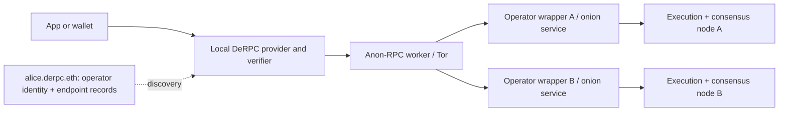

# Operator dashboard and onboarding

Team direction, Nov 6, 2026. This defines the requested product workflow; it is not a statement that every step is deployed. [CONTEXT.md](CONTEXT.md) remains the decision source and [ROADMAP.md](ROADMAP.md) tracks delivery gates.

**Delivery decision:** ship the free demo first. Show staking and operator pricing as planned features; activate them later. The team clarified that network traffic should change the **stake required per node**, rather than the number of nodes allowed. Amounts and the economic mechanism are still undecided. Independent operators' ENS registrations remain deferred until their details are supplied.

The ENS/onion implementation is planned in [M1 — ENS-managed private RPC operators](ENS_TOR_MILESTONE.md), with a live verified-identity lifecycle checkpoint followed by the full multi-endpoint checkpoint. This workflow remains the wider product definition; M1 excludes active staking and payments.

## User journey

1. Open the operator directory, then the live dashboard. See available operators, their endpoints, selection state, ENS provenance, recent local observations and proof results. Unknown or untested endpoints start as **not checked**, never healthy by default. Historical measurements in the static directory retain their date.
2. Choose operators manually, or explicitly apply automatic balanced, fastest or reliable routing. Automatic mode can use all eligible free operators, or only the checked allowlist; an empty restriction permits none. No operator is selected on a first visit before that choice. Saved settings must preserve their source: a proven ENS pool cannot silently become the mock bootstrap roster on reload. Viewing a directory does not send a user's addresses to its operators.
3. Run a supported mainnet read through DeRPC. The browser runs the pinned Anon-RPC worker and authenticates finalized chain state. It accepts an answer only after host-side verification. Show the serving endpoint, verified block, observation time and measured duration.
4. If an endpoint is unavailable, retry within the user's choices. An invalid proof is rejected and its endpoint excluded locally. If no chosen route can serve the request, fail closed. A local failure is not public proof of an operator's misconduct.
5. Inspect operator details, or select **Run an operator** to prepare an onboarding draft. No wallet or deposit is required to use the free pool.

The initial automatic source is the five configured public bootstrap entries, explicitly labeled with mock ENS names and unknown current availability until observed. Future `derpc.eth` refreshes can expand an automatic pool only after both membership and records are proven. Ranking uses recent results from this device; fastest and reliable are preferences, not promises. Per-account affinity takes precedence, retries stay sequential and bounded, and no category broadcasts an account query to the full roster. Payments, personal nodes and simulated corruption remain outside automatic selection. Ethereum mainnet is the only verified chain.

## Operator journey

1. Choose an operator identity such as `alice.derpc.eth` and the public ownership/record-management addresses. Minting an operator identity is an operator action; ordinary readers do not mint an identity to use free reads.
2. Add one or more node entries under that identity. Each needs a stable endpoint ID, execution URL, optional associated beacon URL, chain/capabilities and wrapper identity. A node entry represents an advertised endpoint, not cryptographic proof that it is a distinct physical machine.
3. Run the wrapper beside the execution and consensus clients. Its setup checks proof availability and beacon routes; its bounded proxy and Tor onion service expose the supported paths. The browser independently checks cryptographic proofs. A successful wrapper self-test alone is not a verified-response badge.
4. Prepare the ENS records. The model is **one operator name → several distributed endpoints**. Each endpoint's wrapper identifies the same operator and its own stable node ID; the client validates each endpoint separately. M1-B adds a versioned endpoint record and explicit conversion from a local onboarding draft into an operator configuration fragment. The complete deployment configuration and fresh chain preflight must still validate roles, leases, parent state and other operators before preparing transactions.
5. Later, fund the operator identity stake and the required stake for each registered node, then publish through the approved registration flow. Show the quoted requirement before signing. The existing query escrow is not a staking contract.
6. Later, set the operator's price per verified logical read. Publish terms and configure the wrapper consistently. Changes apply to new sessions; an existing session keeps its agreed price. Adding a node must not silently move an existing paid session to an unrelated settlement process.

The implemented ENS registrar is curated, expiring (at most 30 days per lease) and non-transferable. Operators control their records through their resolver roles; the curator retains registration/revocation powers. Do not describe that as perpetual, unrestricted ENS ownership. Permissionless minting and any different transfer/renewal rights need a replacement registrar design and tests.

## Dashboard evidence

| Display | What it establishes | What it does not establish |
|---|---|---|
| ENS identity / records | Whether a name is a mock, unverified discovery, or proven at an authenticated block | That the owner is honest, independent or operating its own physical node |
| Wrapper identity matched | The endpoint's identity document agrees with the expected ENS name and signer | A signed audit, trustworthy software, or future behavior |
| Last proof verified | One completed supported read matched authenticated finalized state | Every method, a current live health check, or future responses |
| Reachability / latency | This client's recent result, timestamp and duration | Global uptime, an independent watcher score, or guaranteed capacity |
| Anonymous route | Reads used the configured Anon-RPC transport; no direct RPC fallback | Hidden query contents, guaranteed account unlinkability, or immunity to correlation |
| Price / stake | Current published terms once proven and deployed; otherwise clearly planned | Safety, honesty, or a reason to skip response verification |

Stale observations retain their timestamp and become stale/unknown in the UI. A pool entry being eligible only means it can be tried. Distinguish a timeout from an invalid proof. Endpoint changes invalidate old health/identity observations; paid-session destinations remain pinned. Health probes, if added, must be explicit, bounded, anonymous and use public fixtures. No analytics or central collection of users' queries is needed.

## Runtime structure

The operator wrapper is a filtering reverse proxy with an onion service. Anon-RPC runs on the user's side. An ordinary HTTP wallet cannot gain these guarantees by pasting a wrapper URL: it needs the DeRPC provider or a separately built local adapter with anonymous routing and host verification. A shared hosted RPC gateway sees its callers and is not equivalent to that local adapter.

Tor aims to hide the caller's IP from the RPC operator. **The operator still sees addresses, methods, parameters and timing.** Query-content privacy is separate future work. Do not call this hidden-query execution. Proofs allow manipulation of supported answers to be detected and rejected; they do not certify that an endpoint will never be a bad actor.

## Multi-endpoint implementation gate

Current code uses one ID for both operator and endpoint. Adding extra rows without changing that model would either collide in health/payment state or give operators with more URLs extra selection weight. Before enabling distributed endpoints:

- Separate stable operator identity from endpoint identity in discovery, pool state, UI and persistence.
- Define a bounded, versioned `derpc.endpoints` record with unique IDs/URLs, supported URL/chain rules and record-size limits; retain explicitly tested legacy singular-record handling. Reject malformed plural records rather than silently downgrading to a convenient endpoint.
- Extend the operator's scoped resolver update permission for the new record and verify the complete endpoint set through the existing authenticated discovery path. Keep one resolver per operator.
- Select an operator before selecting one of its endpoints. More endpoints provide redundancy, not extra operator weight or independent ownership. Preserve per-account affinity and allow failover only within selected operators.
- Attribute identity checks, proof results, exclusion, cooldowns and freshness to the particular endpoint. Replacement/rotation must not inherit its predecessor's health.
- Test one operator with two endpoints, endpoint outage, corrupt proof, rotated records, removed/expired operator, duplicate endpoints and unchanged operator selection weight.
- Keep multi-endpoint paid sessions disabled until accounting is designed. Current wrapper journals are single-writer; sharing a payee or disk is not coordinated settlement. Choose endpoint-specific sessions or a deliberately coordinated operator accounting service, with restart/replay tests.

## Later staking design: decisions still required

The desired shape is an operator identity deposit plus a traffic-dependent requirement per node. This is a requirement, not a chosen formula. No ETH amount, token, traffic estimate or penalty is invented for the demo.

- Staking chain and asset; initial operator and per-node amounts.
- Definition of network traffic, measurement window and trustworthy aggregation. Raw self-reported requests can be inflated; publishing user query logs is not acceptable.
- Whether higher traffic increases or decreases the requirement, formula, caps, update cadence and notice period.
- Rules for existing deposits when the requirement changes: top-ups, grandfathering or grace period; stop accepting new work before reducing available collateral if necessary.
- Withdrawal/unbonding, expiry, revocation, fees versus refundable deposits, and any governance powers.
- Whether the deposit is slashable. A failed proof seen through an untrusted worker does not by itself prove the operator sent it. Any penalties require attributable signed evidence and dispute rules; downtime or disagreement is not cryptographic evidence.

Staking can impose a cost on identities; it does not prove one operator equals one person, and it does not replace verification. Until economic rules are approved and implemented, use **staking planned** and disable funding/mint actions rather than simulate a successful financial transaction.

## Delivery order and acceptance

1. **Free dashboard and draft onboarding:** show truthful local evidence, working user selection, explicit failure states, draft export, and planned economics. No automatic operator enrollment, new staking transactions or fabricated health. The onboarding draft must say it is not registered, deployed or automatically validated against a live node.
2. **One operator / multiple endpoints:** implement and test the model and record changes above. Drafting several endpoints alone does not satisfy this gate.
3. **Public free path:** resolve onion availability, publish a reliable public Tor gateway/browser deployment, confirm secure committee-period startup, and run the real proof-rejection/failover/shutdown demo. Existing release gates still apply.
4. **Real ENS operators, when details arrive:** register independent operators, prove records, test ownership controls, expiry/revocation and actual discovery. Do not substitute local demo proxies for the team's requested independent registrations.
5. **Economics last:** finalize staking rules, implement registration deposits, operator term updates and safe multi-node accounting, then demonstrate testnet funding/read/settlement/refund. Production money remains subject to the existing readiness gates.

## Free UI implementation and validation, Nov 6

The live demo now lists available operators with explicit selection, endpoint, ENS provenance, timestamped proof observations, conservative latency and local failure counts. Observations come from actual provider events, including bootstrap/directory proof work; no new automatic probes were added. Old observations lose their recent-success styling after 60 seconds, and endpoint/identity changes clear their evidence. Personal endpoint URLs remain redacted, including during status updates before the personal form finishes installing an entry.

The directory links into the dashboard. A known operator in the link is only a suggestion until the user applies their choice. Onboarding validates and exports a local draft with one operator identity and up to eight endpoint/beacon pairs, with ownership, reachability and proofs explicitly unchecked. Editing invalidates the review. No wallet or remote registration is called. The eight-entry limit bounds the draft UI; it is not a deployed registry rule.

Validation: 112 frontend tests passed (including onboarding validation/interaction and dashboard observation tests), plus nine provider directory-consistency tests. Web and frontend type checks/builds passed and the combined static site was assembled. Firefox UI checks passed at 375, 768 and 1280 pixels without page overflow or JavaScript errors. Static onboarding/site checks made no external HTTP requests; dashboard rendering checks used injected provider events. These are UI checks, not a new live onion availability, public deployment or ENS enrollment claim. The release build used the pinned public demo gateway for build validation, not a newly deployed production gateway.

Suggested commit split for these changes, after the existing implementation commits:

1. `specs: define operator dashboard and deferred staking workflow` — `specs/DEMO_WORKFLOW.md`, matching updates in `specs/CONTEXT.md`, `specs/ROADMAP.md`, `REPO_LAYOUT.md` and `AI_USAGE.md`.
2. `web: add free operator onboarding drafts` — `web/src/directory/operator-draft.ts`, `web/src/pages/operate.ts`, the related `web/src/styles.css` additions and `frontend/test/operator-draft.test.ts`; directory/landing/operator copy and dashboard links in `web/src/pages/{directory,landing,operator}.ts` and `web/src/ui.ts`; `web/README.md` and the matching product-context update in `docs/design-system.md`.
3. `frontend: show local operator health and proof observations` — `frontend/src/operator-dashboard.ts`, its test, and the related changes in `frontend/src/main.ts`, `frontend/src/style.css`, `frontend/index.html` and `frontend/test/main.test.ts`.

Only the relevant changes belong in each group; the workspace already contains other pending implementation work. No files were staged or committed by the agents.

## Automatic routing implementation and validation, Nov 6

The dashboard now has Manual, Balanced, Fastest and Reliable strategies. Changes stay pending until Apply. Automatic mode offers all eligible free operators or an exact restriction; applying an empty restriction stops reads. Saved ENS preferences pause on reload until proven discovery is restored, so mock bootstrap names cannot substitute for real saved identities. Personal nodes and simulated corruption use Manual mode; automatic mode never activates payment authorization.

The provider exposes `selection`, `allowedOperators`, mainnet-only `chainId` and atomic `setRouting(policy, candidates?)`. It separates candidate sources from the permitted read pool, requires proven ENS membership and records before automatic directory adoption, and rejects obsolete refreshes. Mode changes preserve account affinity and observations where endpoint identity is unchanged. Routing changes cancel incompatible in-flight requests, including requests still waiting for startup. Old directory snapshots cannot prevent the user from narrowing or closing access. M1-B extends this policy to operator groups: one checkbox/allowlist identity authorizes its current eligible nodes, and extra nodes do not multiply operator selection weight.

Validation on the final source: **350 provider tests and 149 frontend tests passed**. Workspace type checking and `pnpm build:site` passed, producing `web/dist/` with `/demo/`. The build used the pinned public demo gateway to validate release packaging; it is not evidence of a newly deployed public gateway. Firefox UI fixtures passed at 375, 768 and 1280 pixels, including pending changes and empty-list application, without page overflow or JavaScript errors.

Real Firefox evidence through the existing local development gateway:

- [Five-operator roster check](../provider/test/fixtures/automatic-roster-live-2026-11-06.json): dRPC, MEV Blocker, BlockRazor, Blast API and PublicNode each verified the same public WETH balance at mainnet block **26356307**, with each endpoint selected individually. PublicNode required a bounded retry after a proof-window error. The first timing includes the worker-pin proof, so timings are not comparable rankings.
- [Automatic-routing check](../provider/test/fixtures/automatic-routing-live-2026-11-06.json): all five were candidates for balanced mode. Blast served the verified read at block **26356339**; fastest and reliable retained it for fresh nonce/storage reads of the same public account. An empty allowlist failed without additional execution RPC; restricting to `mevblocker.derpc.eth` used only MEV Blocker. The worker pin was verified, no direct execution/beacon RPC was observed, and shutdown produced no subsequent requests.

These observations establish the recorded functional paths and source versions. They do not establish continuous availability, global rankings, independent ownership, real ENS registrations or reliable public-gateway deployment. The existing public release and M1 gates remain open.

Suggested commit split, after the earlier pending implementation groups:

1. `provider: add local automatic operator selection` — routing changes in `provider/src/pool/pool.ts` and `provider/test/pool/selection.test.ts`.
2. `provider: enforce automatic routing authorization` — routing and request-lifecycle changes in `provider/src/api/derpc.ts`, `provider/src/api/eip1193.ts`, `provider/src/index.ts` and `provider/test/api/automatic-routing.test.ts`.
3. `frontend: expose routing strategies and operator restrictions` — `frontend/src/routing-preferences.ts`, `frontend/test/routing-preferences.test.ts`, and routing-related changes in `frontend/src/main.ts`, `frontend/index.html`, `frontend/src/style.css`, `frontend/test/main.test.ts`.
4. `docs: record automatic routing and live validation` — `provider/README.md`, `specs/CONTEXT.md`, `specs/ROADMAP.md`, `specs/DEMO_WORKFLOW.md`, `specs/ENS_TOR_MILESTONE.md`, `REPO_LAYOUT.md`, `AI_USAGE.md` and the two dated routing evidence JSON files above.

Use only the corresponding changes from shared files; earlier uncommitted work remains separate. Nothing was staged or committed.
